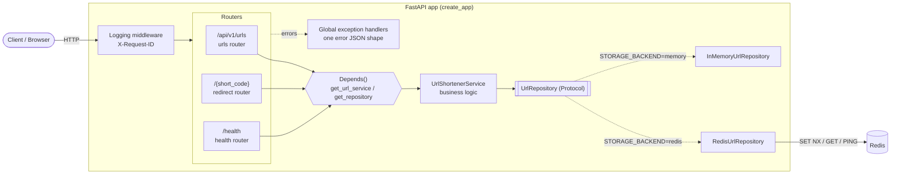

# URL Shortener (FastAPI)

A URL shortener microservice built with **FastAPI**. You send it a long URL, it returns a short
7-character code, and visiting `http://<host>/<code>` redirects (302) to the original URL.
Data is stored in **Redis** (or in memory for quick local runs and tests).

The lab was written for Flask; this project delivers every requirement with the FastAPI
equivalent (see [Flask requirement → FastAPI equivalent](#flask-requirement--fastapi-equivalent)).

---

## Table of contents

- [Features](#features)
- [Requirements](#requirements)
- [Project structure](#project-structure)
- [Local setup (virtual environment)](#local-setup-virtual-environment)
- [Docker setup](#docker-setup)
- [Environment variables](#environment-variables)
- [Endpoints](#endpoints)
- [Error format](#error-format)
- [API documentation (Swagger / OpenAPI)](#api-documentation-swagger--openapi)
- [Running the tests](#running-the-tests)
- [Architecture](#architecture)
- [Flask requirement → FastAPI equivalent](#flask-requirement--fastapi-equivalent)
- [Design decisions](#design-decisions)

---

## Features

- `POST /api/v1/urls` creates a short URL (input validated with Pydantic `HttpUrl`)
- `GET /api/v1/urls/{short_code}` returns the details of a short URL
- `GET /{short_code}` redirects to the original URL with **302 Found**
- `GET /health` checks the app and pings Redis (503 when Redis is down)
- App factory, versioned API (`/api/v1`), settings from environment variables
- Storage abstraction with two implementations: **in-memory** and **Redis** (`SET NX`)
- Dependency injection with FastAPI `Depends()`
- Custom exceptions, global exception handlers and **one consistent error JSON shape**
- Request logging middleware (method, path, status, duration) and `X-Request-ID` header
- Multi-stage Docker image running as a non-root user, Gunicorn + Uvicorn workers
- Docker Compose for development (hot reload + Redis with healthcheck)
- pytest test suite with `TestClient`

## Requirements

- Python **3.14** (3.12+ should also work)
- Docker Desktop with Docker Compose v2 (for the Docker setup)
- Redis 7+ (only if you use `STORAGE_BACKEND=redis` outside Docker)

Main libraries: FastAPI, Pydantic v2, pydantic-settings, redis-py (asyncio), Uvicorn,
Gunicorn + uvicorn-worker, pytest. All versions are pinned:

- [requirements.txt](requirements.txt): **runtime** dependencies only (what the Docker image installs)
- [requirements-dev.txt](requirements-dev.txt): `-r requirements.txt` plus test tools (pytest, httpx)

## Project structure

```
app/
├── main.py                  # create_app() factory, lifespan, middleware, routers
├── core/
│   ├── config.py            # Settings (pydantic-settings) + get_settings()
│   ├── exceptions.py        # AppError, UrlNotFoundError, ...
│   ├── error_handlers.py    # global exception handlers -> one error JSON shape
│   ├── middleware.py        # request logging + X-Request-ID
│   └── logging.py           # log format and level
├── api/
│   ├── router.py            # /api/v1 router
│   ├── dependencies.py      # Depends() providers: repository, service
│   ├── params.py            # shared short_code path parameter
│   ├── responses.py         # documented error responses for OpenAPI
│   └── routes/
│       ├── health.py        # GET /health
│       ├── urls.py          # POST /api/v1/urls, GET /api/v1/urls/{short_code}
│       └── redirect.py      # GET /{short_code}  (catch-all, included last)
├── services/
│   └── url_shortener.py     # UrlShortenerService (business logic)
├── storage/
│   ├── base.py              # UrlRecord + UrlRepository Protocol (interface)
│   ├── memory.py            # InMemoryUrlRepository
│   └── redis.py             # RedisUrlRepository (SET NX)
├── schemas/                 # Pydantic request/response/error models
└── utils/codes.py           # short code generator (secrets)
tests/                       # pytest suite
Dockerfile                   # multi-stage, non-root, Gunicorn by default
docker-compose.yml           # development: app (hot reload) + Redis
docker-compose.prod.yml      # production-like: Gunicorn workers + Redis
gunicorn.conf.py             # Gunicorn settings (workers from WORKERS)
requirements.txt             # runtime dependencies (pinned)
requirements-dev.txt         # runtime + test dependencies (pinned)
```

## Local setup (virtual environment)

Commands are for **Windows PowerShell**.

```powershell
# 1. Create and activate the virtual environment
python -m venv .venv
.\.venv\Scripts\Activate.ps1

# 2. Install dependencies (runtime + test tools)
pip install -r requirements-dev.txt

# 3. Create your local settings file
Copy-Item .env.example .env

# 4. Run in development mode (auto-reload on code changes)
uvicorn app.main:app --reload
```

Open <http://localhost:8000/docs>.

By default `STORAGE_BACKEND=memory`, so no Redis is needed. To use Redis locally, start one
(for example `docker run -d --name redis -p 6379:6379 redis:8-alpine`) and set
`STORAGE_BACKEND=redis` in `.env`.

> If PowerShell blocks the activate script, run once:
> `Set-ExecutionPolicy -Scope CurrentUser RemoteSigned`

> Gunicorn does not run on Windows, so production mode (Gunicorn) is run with Docker.

## Docker setup

### Development (hot reload + Redis)

```powershell
docker compose up --build
```

- The app runs `uvicorn --reload`; your `app/` folder is mounted into the container, so code
  changes reload automatically.
- Redis starts first; the app waits until the Redis **healthcheck** (`redis-cli ping`) passes
  (`depends_on: condition: service_healthy`).
- Values from `.env` are loaded with `env_file` (optional), and `environment:` sets the
  Docker-specific values such as `REDIS_URL=redis://redis:6379/0`.

Useful commands:

```powershell
docker compose ps                                  # status + health
docker compose logs -f app                         # follow the app logs
docker compose exec redis redis-cli KEYS "url:*"   # see stored codes
docker compose down                                # stop (add -v to delete Redis data)
```

### Production profile

The image's default command is production mode: **Gunicorn** managing **Uvicorn workers**.

```powershell
$env:WORKERS = "4"
docker compose -f docker-compose.prod.yml up --build
```

| | Development | Production |
|---|---|---|
| Server | `uvicorn --reload` (1 process) | `gunicorn -c gunicorn.conf.py` with `uvicorn_worker.UvicornWorker` |
| `DEBUG` | `true` | `false` |
| Workers | 1 | `WORKERS` env variable (default 4 in compose) |
| Code | mounted volume (hot reload) | copied into the image |

### The image

- **Multi-stage**: the `builder` stage installs dependencies into `/opt/venv`; the `runtime`
  stage (`python:3.14-slim`) copies only that venv and the app code.
- Runs as a **non-root** user (`app`).
- Has a `HEALTHCHECK` that calls `/health`.
- `.dockerignore` keeps `.env`, `.venv`, `.git` and tests out of the image.

## Environment variables

Copy [.env.example](.env.example) to `.env`. `.env` is git-ignored and must never be committed.

| Variable | Default | Description |
|---|---|---|
| `APP_NAME` | `URL Shortener` | Name shown in the API docs |
| `APP_VERSION` | `0.1.0` | Version shown in the API docs |
| `ENVIRONMENT` | `development` | `development` or `production` (`testing` is used by the tests) |
| `DEBUG` | `false` | `true` = more detailed logs. Stack traces are never sent to clients |
| `BASE_URL` | `http://localhost:8000` | Public address used to build `short_url` (trailing `/` is removed) |
| `STORAGE_BACKEND` | `memory` | `memory` (Python dict) or `redis` |
| `REDIS_URL` | `redis://127.0.0.1:6379/0` | Redis connection URL (used when `STORAGE_BACKEND=redis`). Use `127.0.0.1`, not `localhost`, on Windows (see Running the tests) |
| `WORKERS` | `2` | Number of Gunicorn worker processes in production |

## Endpoints

| Method | Path | Description | Success | Errors |
|---|---|---|---|---|
| `POST` | `/api/v1/urls` | Create a short URL | `201 Created` | `422`, `500`, `503` |
| `GET` | `/api/v1/urls/{short_code}` | Get short URL details | `200 OK` | `404`, `422`, `500`, `503` |
| `GET` | `/{short_code}` | Redirect to the original URL | `302 Found` | `404`, `422`, `500`, `503` |
| `GET` | `/health` | Health check (pings Redis when used) | `200 OK` | `503` |
| `GET` | `/docs` | Swagger UI | `200 OK` | |
| `GET` | `/openapi.json` | OpenAPI schema | `200 OK` | |

**Create a short URL**

```http
POST /api/v1/urls
Content-Type: application/json

{"original_url": "https://www.python.org/about/"}
```

```json
HTTP/1.1 201 Created

{
  "short_code": "aB3dE9x",
  "original_url": "https://www.python.org/about/",
  "short_url": "http://localhost:8000/aB3dE9x",
  "created_at": "2026-11-04T10:15:30.123456Z"
}
```

**Redirect**

```http
GET /aB3dE9x

HTTP/1.1 302 Found
Location: https://www.python.org/about/
```

PowerShell examples:

```powershell
$r = Invoke-RestMethod -Method Post -Uri http://localhost:8000/api/v1/urls `
     -ContentType "application/json" -Body '{"original_url": "https://www.python.org"}'
Invoke-RestMethod http://localhost:8000/api/v1/urls/$($r.short_code)
curl.exe -i http://localhost:8000/$($r.short_code)
```

## Error format

Every error (404, 405, 422, 500, 503) uses the same JSON shape:

```json
{
  "error": {
    "code": "url_not_found",
    "message": "Short URL 'aB3dE9x' was not found.",
    "details": {"short_code": "aB3dE9x"}
  }
}
```

| Status | `code` | When |
|---|---|---|
| 404 | `url_not_found` | The short code does not exist |
| 404 | `not_found` | The route does not exist |
| 405 | `method_not_allowed` | Wrong HTTP method |
| 422 | `validation_error` | Invalid URL, missing body, or badly formed short code (`details` lists each field) |
| 500 | `internal_server_error` | Unexpected error; details are only written to the server log |
| 503 | `storage_unavailable` | Redis is not reachable |

Every response also has an **`X-Request-ID`** header. The same ID appears in the log line:

```
2026-11-04 10:39:25,944 INFO app.requests: POST /api/v1/urls 201 40.36ms request_id=94a9f34b...
```

## API documentation (Swagger / OpenAPI)

- Swagger UI: <http://localhost:8000/docs>
- ReDoc: <http://localhost:8000/redoc>
- Raw schema: <http://localhost:8000/openapi.json>

Each endpoint has a summary, a description, request examples (including an invalid one),
a response example and its documented error responses (404/422/500/503) with the real error shape.

> **Note on the OpenAPI version:** the lab mentions OpenAPI **3.0** (from Flask-RESTX).
> FastAPI generates **OpenAPI 3.1**, the newer version of the same standard, which is fully
> supported by Swagger UI. 3.1 is aligned with JSON Schema, which is what Pydantic produces.

> **Testing the redirect in Swagger:** *Try it out* on `GET /{short_code}` makes the browser
> follow the redirect, which can show "Failed to fetch". Open the `short_url` in a browser tab
> or use `curl.exe -i` to see the 302 and the `Location` header.

## Running the tests

```powershell
.\.venv\Scripts\Activate.ps1
pytest
```

The unit and API tests use `create_app()` with test settings (`STORAGE_BACKEND=memory`), so
no Redis or Docker is needed. They cover:

- create (201), invalid URL and missing body (422), badly formed short code (422)
- info (200), unknown code (404)
- redirect (302 with the correct `Location` header), unknown code (404)
- health (200), and 503 when storage is down (using `dependency_overrides`)
- the error JSON shape for 404, 405, 422 and 500 (no internal details leaked)
- `X-Request-ID` header
- service logic: collision retry and giving up after too many collisions
- both repositories (in-memory and Redis with a fake client): `SET NX` behaviour

### Integration tests (real Redis)

[tests/test_redis_integration.py](tests/test_redis_integration.py) runs against a **real Redis**
and is **skipped automatically** when Redis is not reachable. It checks the save/get round trip,
that `SET NX` refuses an existing code, that 20 concurrent saves of the same code produce
exactly one winner (atomicity), and the full API flow with `STORAGE_BACKEND=redis`.

```powershell
docker compose up -d redis          # Redis on 127.0.0.1:6379
pytest                              # all tests, integration included
pytest -m integration               # only the integration tests
pytest -m "not integration"         # skip them
docker compose down
```

The tests use Redis database **15** (`REDIS_TEST_URL`, default `redis://127.0.0.1:6379/15`)
and delete only the keys they create.

> Use `127.0.0.1` rather than `localhost` for Redis on Windows: `localhost` tries IPv6 (`::1`)
> first, which the Docker port does not listen on, so every connection would wait for a timeout.

## Architecture



**How a request flows:**

1. The **logging middleware** gives the request an ID, starts a timer, and passes it on.
2. The matching **router** validates the input with Pydantic (bad input → 422).
3. **`Depends()`** builds the `UrlShortenerService` and gives it the repository that was created
   once at startup.
4. The **service** applies the business rules (generate a code, retry on collision, build `short_url`).
5. The **repository** talks to storage. Both implementations follow the same `UrlRepository`
   Protocol, so the service does not know or care which one is used.
6. If anything raises an error, a **global exception handler** turns it into the error JSON shape.
7. The middleware logs method, path, status and duration, and adds `X-Request-ID` to the response.

**Application vs request data**

- **Application level** (`app.state`): created once in `create_app` / the **lifespan** handler and
  shared by all requests: `settings`, the async Redis client, the repository. The lifespan
  closes the Redis client on shutdown.
- **Request level** (`Request`, `request.state`): data for one request only, such as headers and
  `request.state.request_id`.

## Flask requirement → FastAPI equivalent

| Flask (lab) | FastAPI (this project) | Where |
|---|---|---|
| Application factory `create_app()` | `create_app(settings)` returning a `FastAPI` app | [app/main.py](app/main.py) |
| Blueprints | `APIRouter` | [app/api/routes/](app/api/routes/) |
| Blueprint URL prefix for versioning | `APIRouter(prefix="/api/v1")` | [app/api/router.py](app/api/router.py) |
| Flask-Injector | `Depends()` (built-in dependency injection) | [app/api/dependencies.py](app/api/dependencies.py) |
| python-decouple | pydantic-settings (typed, validated settings from env / `.env`) | [app/core/config.py](app/core/config.py) |
| Flask-RESTX docs (Swagger, OpenAPI 3.0) | Built-in OpenAPI **3.1** + Swagger UI at `/docs` | automatic, polished in the routes |
| Flask-RESTX / marshmallow validation | Pydantic models (`HttpUrl`) | [app/schemas/](app/schemas/) |
| Application context (`current_app`, app-level `g`) | `app.state` (+ lifespan for startup/shutdown) | [app/main.py](app/main.py) |
| Request context (`request`, per-request `g`) | `Request` object and `request.state` | [app/core/middleware.py](app/core/middleware.py) |
| `@app.errorhandler` | `app.add_exception_handler` | [app/core/error_handlers.py](app/core/error_handlers.py) |
| `before_request` / `after_request` | HTTP middleware | [app/core/middleware.py](app/core/middleware.py) |
| WSGI server: Gunicorn (sync workers) | ASGI: Gunicorn with **Uvicorn workers** | [gunicorn.conf.py](gunicorn.conf.py) |
| `flask run --debug` (reloader) | `uvicorn --reload` | [docker-compose.yml](docker-compose.yml) |
| Flask test client | `fastapi.testclient.TestClient` | [tests/](tests/) |

## Design decisions

- **Redirect at the root (`/{short_code}`), not under `/api/v1`.** Short links must be as short
  as possible (`http://host/aB3dE9x`). The management API is versioned; the short links are
  not, because they are shared publicly and must never change. Because `/{short_code}` matches
  any single path segment, its router is **included last** so `/health`, `/docs` and
  `/openapi.json` still work.
- **302 Found instead of 301 Moved Permanently.** Browsers cache 301 forever, so later
  requests would skip our server. 302 keeps every visit going through the service, so a link
  could later be changed, disabled or counted (analytics in a later module).
- **`secrets` for short codes.** `secrets.choice` uses a cryptographically secure random source,
  so codes cannot be predicted or enumerated (unlike `random`). 7 characters from 62 letters
  and digits give 62⁷ ≈ 3.5 trillion combinations.
- **No collisions: `SET NX`.** The repository saves with "only if it does not exist"
  (`SET key value NX` in Redis, a check-and-insert in memory). Redis does this atomically,
  so two requests can never overwrite each other. On a clash the service retries with a new
  code (up to 5 times).
- **UTC times.** `created_at` is created with `datetime.now(timezone.utc)` and returned in ISO 8601
  with a timezone, so it is unambiguous for clients in any time zone.
- **Storage abstraction.** `UrlRepository` is a `typing.Protocol` with two implementations.
  The backend is chosen with `STORAGE_BACKEND`, tests use the in-memory one, and a future
  PostgreSQL repository can be added without touching the service or the routes.
- **Short code format validated.** A badly formed code (wrong length or characters) returns
  422 before any storage lookup; a well-formed but unknown code returns 404.
- **No stack traces for users.** `FastAPI(debug=...)` is not used, because it would send stack
  traces to clients. `DEBUG` only changes the log level; the full trace is always in the server log.
- **Health check returns 503 when Redis is down**, so Docker and load balancers can see that
  the instance is not able to serve requests.
