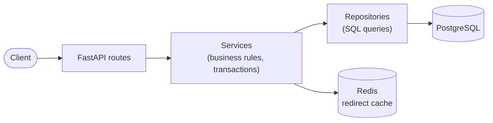
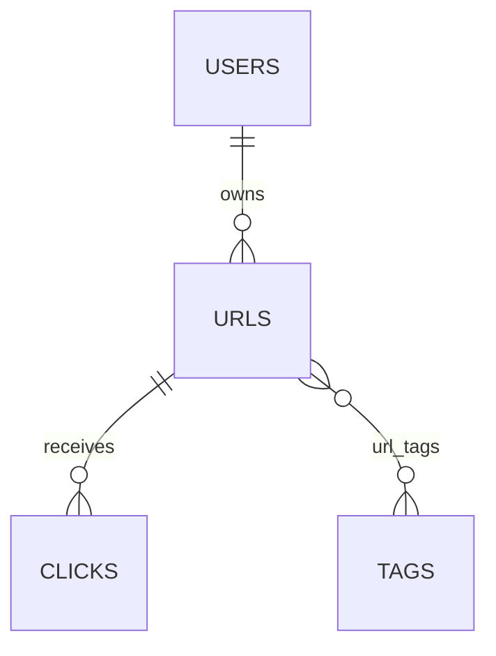

# URL Shortener

A URL shortening service (like Bitly): create short links with an optional custom alias,
expiry date and tags, get redirected when you open them, and see click analytics.

Built with **FastAPI** (approved by the instructor instead of Django), **async SQLAlchemy 2.0**,
**Alembic**, **PostgreSQL** and **Redis**.

## Architecture



## Data model



| Table | Main fields |
|---|---|
| `users` | email (unique), username, is_premium, tier (Free / Premium / Admin) |
| `urls` | original_url, short_code (unique, indexed), custom_alias, owner, is_active, expires_at, title, description, favicon, click_count, created_at (indexed) |
| `clicks` | url, clicked_at, ip_address, user_agent, referrer, country, city |
| `tags` | name (unique), linked to URLs many-to-many |

## Setup

### With Docker

```bash
docker compose up --build
```

This starts PostgreSQL, Redis, runs the database migrations, then starts the app.

- API docs (Swagger): <http://localhost:8000/docs>
- Health check: <http://localhost:8000/health>

Production mode (Gunicorn):

```bash
POSTGRES_PASSWORD=your-password docker compose -f docker-compose.prod.yml up --build
```

### Without Docker for the app

```bash
python -m venv .venv
.venv\Scripts\activate             # macOS/Linux: source .venv/bin/activate
pip install -r requirements-dev.txt
cp .env.example .env

docker compose up -d db redis      # PostgreSQL and Redis
alembic upgrade head               # create the tables
uvicorn app.main:app --reload
```

Settings are read from environment variables; see [.env.example](.env.example).

### Database commands

```bash
alembic upgrade head               # apply all migrations
alembic downgrade -1               # undo the last migration
python -m app.scripts.seed         # fill the database with sample data
```

## API endpoints

| Method | Endpoint | Description |
|---|---|---|
| `POST` | `/api/v1/urls/` | Create a short URL |
| `GET` | `/api/v1/urls/` | List your URLs |
| `GET` | `/api/v1/urls/{short_code}/` | Get URL details (owner, tags, click count) |
| `PUT` | `/api/v1/urls/{short_code}/` | Update a URL |
| `DELETE` | `/api/v1/urls/{short_code}/` | Delete a URL |
| `GET` | `/api/v1/analytics/{short_code}/` | Click analytics (per country, city, day, referrer) |
| `GET` | `/{short_code}/` | Redirect to the original URL (302) |
| `GET` | `/health` | Database and cache status |

### Create a short URL

```bash
curl -X POST http://localhost:8000/api/v1/urls/ \
  -H "Content-Type: application/json" \
  -d '{"original_url": "https://www.python.org/", "custom_alias": "python", "tags": ["Marketing"]}'
```

`custom_alias`, `expires_at` and `tags` are optional.

### List your URLs

```bash
curl "http://localhost:8000/api/v1/urls/?limit=20&sort=newest&tag=Marketing"
```

Optional filters: `tag`, `is_active`, `expired`, `search`. Sort: `newest` or `most_clicked`.
Results are paginated: pass the returned `next_cursor` as `?cursor=...` to get the next page.

### Errors

All errors use the same format:

```json
{"error": {"code": "url_not_found", "message": "Short URL 'abc1234' was not found.", "details": {"short_code": "abc1234"}}}
```

Common status codes: `404` not found, `409` alias already taken, `410` link expired or
deleted, `422` invalid input.

## Tests

```bash
docker compose up -d db            # the tests need PostgreSQL
pytest                             # run all tests
pytest --cov                       # with a coverage report
```

Code quality (also run automatically on GitHub for every push):

```bash
ruff check .                       # lint, including docstrings
ruff format --check .              # formatting
mypy                               # type checking
```

## Project structure

```
app/
├── api/            # routes and dependencies
├── models/         # database models (User, URL, Click, Tag)
├── schemas/        # request and response models
├── repositories/   # database queries
├── services/       # business logic
├── cache/          # Redis redirect cache
├── core/           # settings, errors, logging
├── db/             # database connection
└── scripts/        # seed data
alembic/            # database migrations
tests/
```
