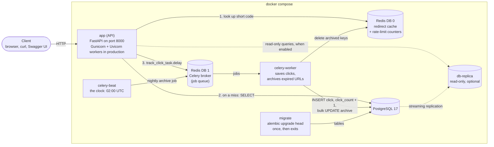
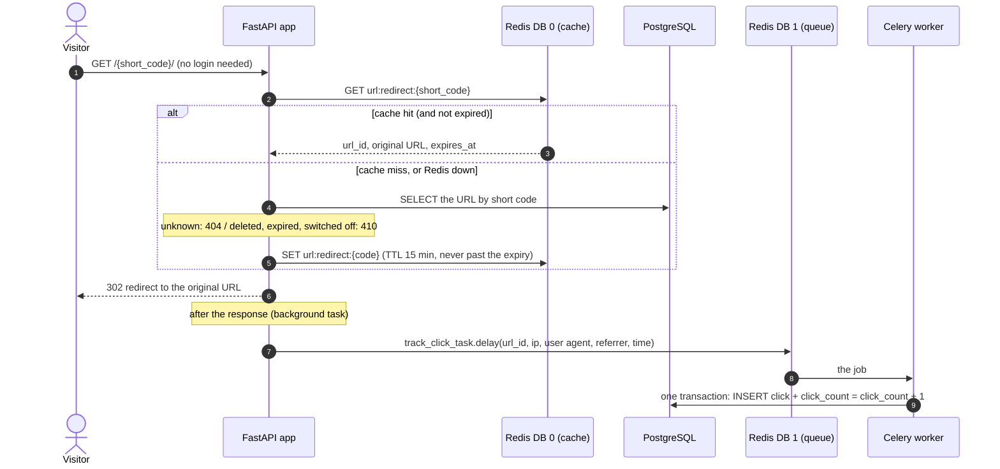
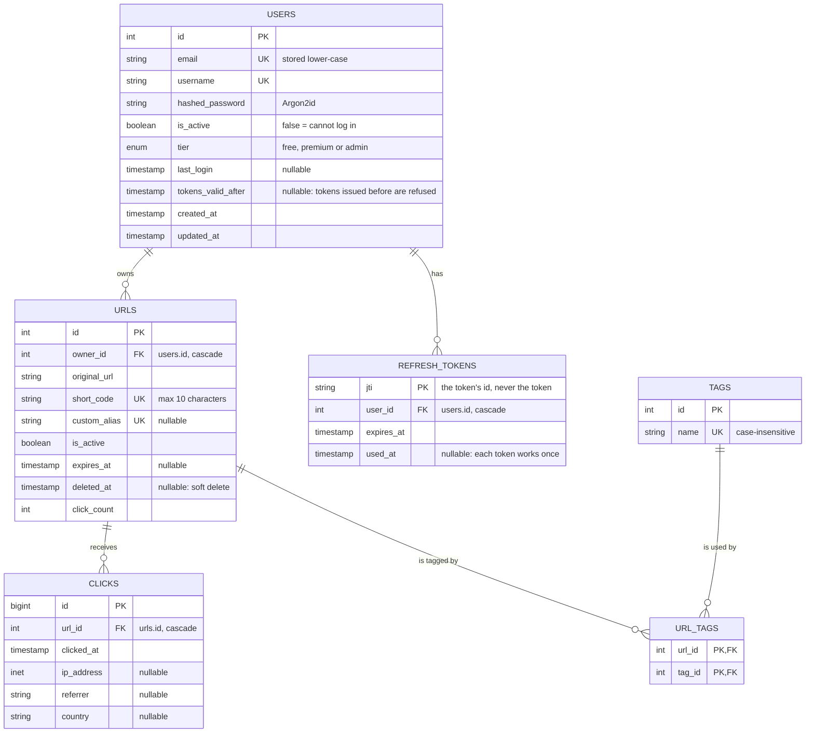
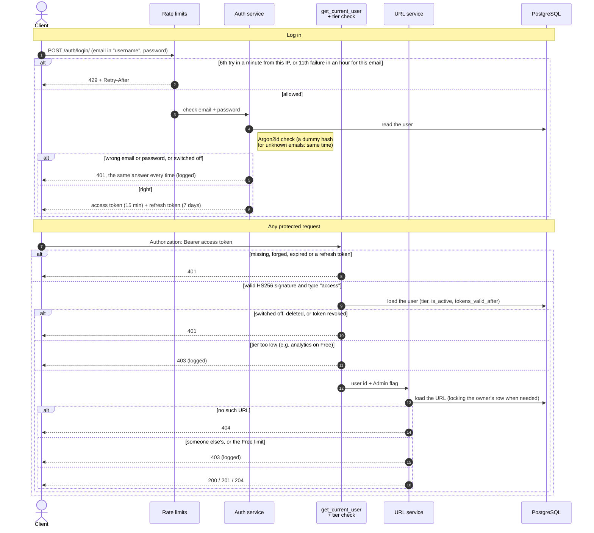

# URL Shortener

A URL shortening service (like Bitly): create short links with an optional custom alias,
expiry date and tags, follow them to be redirected, and see click analytics. Users log in
with JWT tokens, and what they may do depends on their tier (Free, Premium or Admin).

Built with **FastAPI** (approved by the instructor instead of Django + DRF),
**async SQLAlchemy 2.0**, **Alembic**, **PostgreSQL**, **Redis** (cache and job queue),
**Celery** (background jobs) and **Gunicorn** (production server).

## Quick start

### With Docker

```bash
docker compose up --build
```

This starts PostgreSQL and Redis, runs the database migrations, then starts the app, a
Celery worker (saves clicks in the background) and Celery beat (the nightly archive).

- API docs (Swagger): <http://localhost:8000/docs>
- Health: <http://localhost:8000/health> (readiness), <http://localhost:8000/health/live> (liveness)

Production mode (Gunicorn with Uvicorn workers, JSON logs):

```bash
POSTGRES_PASSWORD=... JWT_SECRET_KEY=... docker compose -f docker-compose.prod.yml up --build
```

Useful Docker commands:

```bash
docker compose ps                                  # every service and its health
docker compose logs -f app celery-worker           # follow the JSON logs
docker compose restart celery-worker               # after changing a task (no hot reload)
# run the nightly archive now, instead of waiting for 02:00 UTC
docker compose exec celery-worker celery -A app.worker.celery_app:celery_app call urls.archive_expired
# is the worker alive, and which tasks does it know?
docker compose exec celery-worker celery -A app.worker.celery_app:celery_app inspect registered
docker compose exec redis redis-cli -n 0 --scan --pattern 'url:redirect:*'   # cached redirects
docker compose --profile monitoring up -d prometheus   # metrics UI: http://localhost:9090
# traces: start Jaeger, then the app and worker with tracing on (UI: http://localhost:16686)
docker compose --profile tracing up -d jaeger
OTEL_EXPORTER_OTLP_ENDPOINT=http://jaeger:4318 docker compose up -d app celery-worker
```

### Without Docker for the app

```bash
python -m venv .venv
.venv\Scripts\activate             # macOS/Linux: source .venv/bin/activate
pip install -r requirements-dev.txt
cp .env.example .env               # then set JWT_SECRET_KEY (see Configuration)

docker compose up -d db redis      # PostgreSQL and Redis
alembic upgrade head               # create the tables
uvicorn app.main:app --reload

# in two more terminals: the worker (saves clicks) and beat (nightly archive)
celery -A app.worker.celery_app:celery_app worker --loglevel=INFO --pool=solo   # --pool=solo on Windows
celery -A app.worker.celery_app:celery_app beat --loglevel=INFO
```

Without a worker the redirects still work; the clicks wait in the Redis queue until a
worker starts.

### Database commands

```bash
alembic upgrade head               # apply all migrations
alembic downgrade -1               # undo the last migration
python -m app.scripts.seed         # fill the database with sample data
```

## Configuration

Settings are read from environment variables (or `.env`); see [.env.example](.env.example).

| Variable | Default | Meaning |
|---|---|---|
| `JWT_SECRET_KEY` | **none (required)** | Signs the tokens. The app refuses to start if it is missing or shorter than 32 characters. Create one: `python -c "import secrets; print(secrets.token_urlsafe(48))"` |
| `ACCESS_TOKEN_MINUTES` / `REFRESH_TOKEN_DAYS` | `15` / `7` | Token lifetimes |
| `LOGIN_RATE_LIMIT` | `5/minute` | Login attempts per client IP |
| `LOGIN_ACCOUNT_RATE_LIMIT` | `10/hour` | Failed logins per account (email), from any IP |
| `REGISTER_RATE_LIMIT` | `10/hour` | Registrations per client IP |
| `CREATE_URL_RATE_LIMIT` | `30/minute` | New short URLs per user |
| `RATE_LIMIT_STORAGE_URI` | empty | Where rate-limit counters live. Empty = `REDIS_URL` if set, else in memory |
| `REDIS_URL` | empty | Redis **DB 0**: the redirect cache and the rate limits. Empty = no cache |
| `CACHE_TTL_SECONDS` | `900` | Longest time a redirect stays cached (never past the link's expiry) |
| `CELERY_BROKER_URL` | `redis://127.0.0.1:6379/1` | Celery's job queue: Redis **DB 1**. Must differ from the cache's DB |
| `GEOIP_DATABASE_PATH` | empty | MaxMind GeoLite2-City file: the worker saves each click's country and city. Empty = "Unknown". See [geoip/README.md](geoip/README.md) |
| `OTEL_EXPORTER_OTLP_ENDPOINT` | empty | Where traces go (OTLP/HTTP), e.g. `http://jaeger:4318`. Empty = tracing off |
| `OTEL_SERVICE_NAME` / `OTEL_TRACES_SAMPLER_RATIO` | `url-shortener` / `1.0` | Name in the tracing UI (`-api`, `-worker`); share of traces kept |
| `METRICS_TOKEN` | empty | When set, `GET /metrics` needs `Authorization: Bearer <token>` |
| `LOG_FORMAT` | `json` | `json`: one JSON object per line; `text`: for reading by eye |
| `WEB_CONCURRENCY` | 2 x CPU cores + 1 | Gunicorn worker processes |
| `DB_POOL_SIZE` / `DB_MAX_OVERFLOW` | `3` / `2` | Database connections per web worker (kept open / extra when busy) |
| `DB_POOL_TIMEOUT` | `10` | Seconds a request waits for a free connection |
| `DB_MAX_CONNECTIONS` | `100` | PostgreSQL's `max_connections`: Gunicorn refuses to start if the workers could need more |
| `CELERY_CONCURRENCY` | `2` | Celery worker processes (counted in the connection math) |
| `BASE_URL` / `OWN_HOSTS` | `http://localhost:8000` / empty | This shortener's own host names: short links may not point to them |
| `FORWARDED_ALLOW_IPS` | `127.0.0.1` | Behind a reverse proxy: the proxy's IP, so the real client IP is used |

`docker compose up` sets a development-only `JWT_SECRET_KEY`; `docker-compose.prod.yml`
refuses to start without your own.

## Architecture

### Services (Docker Compose)



- **migrate** runs the database migrations first; the app and the worker start only after it succeeded.
- **One Redis server, two DB numbers:** DB 0 caches redirects and holds the rate-limit
  counters; DB 1 is Celery's job queue. Clearing the cache can never delete queued jobs.
  In production Redis evicts only keys with a TTL (`volatile-lru`), so jobs are never evicted.
- **celery-worker** takes jobs from the queue: it saves each click and runs the nightly archive.
- **celery-beat** is the clock: at 02:00 UTC it puts the archive job on the queue. Run exactly one.
- **Redis down:** redirects still work (read from the database), rate limits count in
  memory, and clicks are lost (logged). `/health/ready` answers 503.
- **db-replica** is optional: when enabled, read-only endpoints use it.

### Inside the app (layers)

| Layer | Folder | Job |
|---|---|---|
| Routes | `app/api/routes` | Receive the request, validate it, return the response |
| Auth and permissions | `app/api/auth.py`, `app/api/permissions.py` | Who is calling (Bearer token) and which tier they need |
| Schemas | `app/schemas` | The JSON coming in and going out (Pydantic) |
| Services | `app/services` | Business rules, ownership checks and the database transaction |
| Repositories | `app/repositories` | Every SQL query |
| Models | `app/models` | The database tables (SQLAlchemy) |
| Cache | `app/cache` | Redis cache-aside for redirects |
| Worker | `app/worker` | Celery app, tasks (sync SQLAlchemy with psycopg), the click tracker |

### What happens when someone opens a short link



The redirect itself never writes to the database: a cache hit needs no database at all,
and the click is saved a moment later by the worker (write-behind). **302, not 301:** a
browser remembers a 301 forever and stops asking us, so later clicks would never be counted.

## Data model



- **`is_premium` is not a column.** `tier` is the single source of truth, and `is_premium` is
  a read-only property (`tier` is Premium or Admin), so the two can never disagree. A
  migration removed the old column; its downgrade rebuilds it from `tier`.
- **Deleting a URL is a soft delete:** `deleted_at` is set, so the short code is never reused
  and its click history is kept. A deleted URL answers `404` in the API and `410` on redirect.
- A URL is **active** (live) when it is switched on, not deleted and not expired.

## API endpoints

| Method | Endpoint | What it does | Who may call it |
|---|---|---|---|
| `POST` | `/api/v1/auth/register/` | Create an account | Anyone (10/hour per IP) |
| `POST` | `/api/v1/auth/login/` | Log in, get an access + refresh token | Anyone (5/minute per IP) |
| `POST` | `/api/v1/auth/refresh/` | Swap a refresh token for a new pair | Anyone with a refresh token |
| `POST` | `/api/v1/auth/logout/` | End this device's session (send its refresh token) | Anyone with a refresh token |
| `POST` | `/api/v1/auth/logout-all/` | End every session of the account at once | Logged in |
| `GET` | `/api/v1/auth/me/` | The logged-in user | Logged in |
| `POST` | `/api/v1/urls/` | Create a short URL | Logged in (30/minute per user) |
| `GET` | `/api/v1/urls/` | List your URLs (pages, filters, sort) | Logged in: only your own |
| `GET` | `/api/v1/urls/{short_code}/` | URL details | Owner or Admin |
| `PUT` | `/api/v1/urls/{short_code}/` | Update a URL | Owner or Admin |
| `DELETE` | `/api/v1/urls/{short_code}/` | Soft-delete a URL | Owner or Admin |
| `GET` | `/api/v1/analytics/{short_code}/` | Click analytics | Premium or Admin; own URLs (Admin: any) |
| `GET` | `/{short_code}/` | Redirect (302) | Anyone |
| `GET` | `/health` | Readiness: PostgreSQL (`SELECT 1`) and Redis (`PING`); `200` or `503` | Anyone |
| `GET` | `/health/ready` | Same check as `/health` (for load balancers) | Anyone |
| `GET` | `/metrics` | Prometheus metrics (not in Swagger); see below | Prometheus (`METRICS_TOKEN` if set) |
| `GET` | `/health/live` | Liveness: the process answers; checks nothing else (Docker `HEALTHCHECK`) | Anyone |

`GET /health` answers `200` like this, or `503` with `"status": "unhealthy"` and the failing
part `"down"` (`"disabled"` = not configured, which is fine):

```json
{"status": "healthy", "database": "ok", "replica": "disabled", "cache": "ok"}
```

Every error has the same shape:

```json
{"error": {"code": "url_not_found", "message": "Short URL 'abc1234' was not found.", "details": {"short_code": "abc1234"}}}
```

| Status | When |
|---|---|
| `401` | No token, or a bad, expired, revoked or wrong-type token (`WWW-Authenticate: Bearer`) |
| `403` | Someone else's URL, a Premium feature on Free, or the Free limit of 10 active URLs |
| `404` / `410` | Unknown or deleted URL / a short link that expired or was deleted |
| `409` | A custom alias or chosen username that is already taken |
| `413` / `422` | Body over 64 KB / invalid input |
| `429` | Too many attempts (`Retry-After` says when to try again) |

### Metrics (Prometheus)

| Metric | Type | Labels | Answers |
|---|---|---|---|
| `http_requests_total` | counter | `method`, `route`, `status` | Requests per second, error rate per endpoint |
| `http_request_duration_seconds` | histogram | `method`, `route` | p50 / p95 / p99 latency per endpoint |
| `http_requests_in_progress` | gauge | `method` | How busy the workers are right now |
| `redirect_cache_lookups_total` | counter | `result` = hit / miss / error | Cache hit ratio; Redis errors |
| `click_events_total` | counter | `outcome` = queued / lost | Lost clicks (alert when > 0) |

`route` is the route **template** (`/{short_code}`), never the real path, and unknown paths
are `unmatched`: one series per route instead of one per short code. Under Gunicorn every
worker writes to `PROMETHEUS_MULTIPROC_DIR` and `/metrics` adds them up (seen live: 3
workers counted 4 + 16 + 12; one scrape showed 32).

### Traces (OpenTelemetry)

With `OTEL_EXPORTER_OTLP_ENDPOINT` set, every request becomes a trace that follows it
through the API, PostgreSQL, Redis, the Celery queue and the worker (the task message
carries the W3C `traceparent`). Every JSON log line written inside a span has its
`trace_id` and `span_id`, so a log line leads to its trace and back. One real redirect,
as Jaeger showed it:

```text
+0.0 ms    77.6 ms  api     GET /{short_code}
+22.8 ms    7.8 ms  api       GET                (Redis: cache miss)
+62.8 ms   10.5 ms  api       SELECT             (PostgreSQL)
+75.8 ms    0.8 ms  api       SET                (Redis: cache filled)  -> 302 sent
+203.6 ms  28.0 ms  api     apply_async/clicks.track_click   (after the response)
+236.4 ms 335.2 ms  worker  run/clicks.track_click
+543.5 ms  14.2 ms  worker    INSERT             (the click)
+563.4 ms   2.2 ms  worker    UPDATE             (click_count + 1)
```

`/health*` and `/metrics` are not traced; SQL spans hold placeholders, never values.

## Authentication

```bash
# 1. Register (email + password of 8-128 characters). Every account starts on Free.
curl -X POST http://localhost:8000/api/v1/auth/register/ \
  -H "Content-Type: application/json" \
  -d '{"email": "aline@example.com", "password": "a-long-passphrase"}'

# 2. Log in: an OAuth2 password FORM, with the email in "username"
curl -X POST http://localhost:8000/api/v1/auth/login/ \
  -d "username=aline@example.com" -d "password=a-long-passphrase"
# -> {"access_token": "eyJ...", "refresh_token": "eyJ...", "token_type": "bearer"}

# 3. Send the access token with every request
curl http://localhost:8000/api/v1/urls/ -H "Authorization: Bearer <access_token>"

# 4. After 15 minutes (401): get a new pair with the refresh token
curl -X POST http://localhost:8000/api/v1/auth/refresh/ \
  -H "Content-Type: application/json" -d '{"refresh_token": "<refresh_token>"}'

# 5. Log out this device (no access token needed), or every device at once
curl -X POST http://localhost:8000/api/v1/auth/logout/ \
  -H "Content-Type: application/json" -d '{"refresh_token": "<refresh_token>"}'
curl -X POST http://localhost:8000/api/v1/auth/logout-all/ -H "Authorization: Bearer <access_token>"
```

**Logging out:** `/logout/` marks that refresh token as used (`204`, also when called
again), so a copy that comes back later is caught as a reuse. The access token is not stored
on the server, so the client forgets it and it runs out within 15 minutes. `/logout-all/`
revokes every refresh token and sets `users.tokens_valid_after`, so every access token stops
working at once, this one too.

**In Swagger (`/docs`):** register, then click **Authorize**, type your **email in the
`username` field** and your password (leave `client_id` and `client_secret` empty). Every
request then sends the token.

| | Access token | Refresh token |
|---|---|---|
| Used for | every request (`Authorization: Bearer ...`) | only `POST /auth/refresh/` and `/auth/logout/` |
| Lives | 15 minutes | 7 days, and works **once** |
| Contains | only `sub` (user id), `type`, `iat`, `exp`, `jti` | the same five claims |

## Authorization

Two questions are checked, in this order:

1. **Who are you?** The Bearer token (`app/api/auth.py`). Missing or bad: `401`.
2. **May you do this?** Not allowed: `403`.
   - **By tier**, as FastAPI dependencies (`require_tier`, `require_premium` in
     `app/api/permissions.py`).
   - **By ownership**, where the URL is loaded (`app/services/urls.py`): unknown or deleted
     `404`, someone else's `403`; an Admin may read, change and delete any URL.

| | Free | Premium | Admin |
|---|---|---|---|
| Active URLs | at most **10** | unlimited | unlimited |
| Custom alias | no (`403`) | yes | yes |
| Analytics | no (`403`) | own URLs | every URL |
| Other people's URLs | no | no | read, change, delete |

- The tier is read **from the database on every request**, never from the token, so a
  promotion or a downgrade counts at once. Tiers are changed only in the database: there is
  no public endpoint for it.
- The 10-URL limit belongs to the account: switching an old URL back on, or giving an expired
  one a new date, is refused too. It is checked under a row lock (`SELECT ... FOR UPDATE` on
  the owner's row, in the same transaction as the insert), so two requests at the same moment
  can never both add the 10th URL. A downgraded user keeps their URLs but cannot add more.
- `owner_id`, `click_count` and `short_code` can never be sent (`422`).

## Security

### The authentication flow



### What protects the accounts

- **Passwords** are stored only as **Argon2id** hashes (pwdlib). An unknown email still runs
  one check against a dummy hash, so the response time does not show which emails exist.
- **Tokens** (PyJWT) are always decoded with `algorithms=["HS256"]` (`alg: none` is refused),
  and the `type` claim is checked: an access token is refused at `/refresh/`, a refresh token
  everywhere else.
- **Refresh tokens work once.** Their id (`jti`) is stored; using one marks it used in one
  atomic `UPDATE`. If a used one comes back, someone kept a copy, so **every token of that
  account is revoked at once** (`users.tokens_valid_after`), access tokens included.
- **No hint about which emails exist:** every failed login gets the same `401`, and register
  answers the same `202` for a new and a taken email (with the same slow hash).
- **Rate limits** stop password guessing and abuse: login per IP and per account, register
  per IP, URL creation per user. They count in Redis, shared by all workers; if Redis is
  down they count in memory and never cause an error. The client IP is never read from
  `X-Forwarded-For` (anyone can fake it).
- **Input validation:** `original_url` must be `http` or `https`, at most 2048 characters,
  with no `user:password@` and never one of our own hosts (the link would loop).
  `custom_alias` is 3-10 characters of `A-Z a-z 0-9 _ -` and may not be a reserved name
  (`api`, `docs`, `redoc`, `openapi.json`, `admin`, `health`, `static`). Unknown fields are
  refused, bodies over 64 KB get `413`.
- **Logging:** failed logins (masked email + IP), every `403` (code, path, user id) and
  rate-limit hits go to the `app.security` log. Passwords, tokens and the `Authorization`
  header are never logged, and client text is cleaned so nobody can fake a log line.
- **Clean errors:** a crash answers a plain `500` with a request id; the stack trace stays in
  the server log. Every response has `X-Content-Type-Options: nosniff` and
  `X-Frame-Options: DENY`.
- **Dependencies:** every package is pinned; CI checks them for known vulnerabilities
  (`pip-audit`) on every push and every Monday.

## Decisions and differences from the brief

| Topic | Decision | Why |
|---|---|---|
| Framework | FastAPI instead of Django + DRF | Approved by the instructor; every Django requirement has a FastAPI equivalent |
| `is_premium` | A read-only property of `tier`, not a column | One source of truth: the two can never disagree |
| Delete | Soft delete with `deleted_at` (not `is_active=False`) | `is_active` stays the owner's on/off switch; deleted codes are never reused |
| Someone else's URL | `403`; unknown code `404` | As in the brief; short codes are public anyway (the redirect is public) |
| Register answer | **`202` with one message for every email** | **Replaces brief tests #1 and #4** (`201` with `id`/`email`/`tier`, `409` for a taken email): both would tell an attacker which emails exist. `GET /auth/me/` shows the account after login |
| Rate-limit storage | **Redis** (in memory when no Redis is configured) | Goes beyond the brief (in memory, Redis in Module 8): with several workers, in-memory counts are per worker, so "5 per minute" would really be 5 x workers |
| Extra limits | Per-account failed logins, register per IP, URL creation per user | Stop botnets, account spam and mass creation of spam links |
| Token revocation | Refresh tokens work once; reuse revokes every token of the account | A stolen token stops working at once instead of after 7 days |
| Logout | **Added back for tokens:** `/logout/` (one device, refresh token in the body) and `/logout-all/` (every device) | The Module 6 cookie logout was removed with the cookies. `/logout/` needs no access token (RFC 7009), so it still works after the access token expired |
| Username | Optional at register, made from the email | The brief's model has no username; the existing table requires one |
| Tier values | Lower-case `free`, `premium`, `admin` | Kept from the existing database type |

## Module 8 design decisions

The Module 8 brief is written for Django; each part has a FastAPI equivalent:
`django-redis` -> `redis.asyncio` client created in the app lifespan; Celery + Redis broker
(same); Gunicorn WSGI -> Gunicorn with `uvicorn_worker.UvicornWorker` (ASGI); JSON logging
with `logging.config.dictConfig`.

| Decision | What we gain | What we pay |
|---|---|---|
| **Cache-aside** for redirects, key `url:redirect:{short_code}`, only `url_id`, URL and expiry | A cache hit needs no database; Redis down = slower, never broken | First visit is always a miss; invalidation is our job |
| TTL 15 min, **never past the link's expiry**; expiry checked again on read | An expired link is never served from the cache | Short-lived links are cached for less time |
| Invalidate with a 30 s **tombstone** + `SET NX` (not a plain DELETE) | A slow request cannot write the old target back after a change | For 30 s after a change every visit reads the database |
| **Write-behind clicks**: the redirect queues `track_click_task` after the response | The visitor never waits for the two writes | `click_count` is a moment behind; clicks are lost (and logged) while the broker is down |
| Task gets **only simple values** (ids, strings, the click time as text) | JSON-safe; no stale ORM object from another process | The worker reads the database itself |
| `click_count = click_count + 1` **in SQL** | Two clicks at the same moment both count (no lost update) | — |
| Retries with backoff + jitter, only for DB connection errors and deadlocks | Survives a database restart | A click may be saved up to ~2 min late |
| Worker uses a **sync** SQLAlchemy engine (psycopg), statements shared with the API | Celery's normal style; pooled connections per worker process | The same SQL runs on two drivers |
| Publishing fails fast (no retries, 1 s connect timeout) | A dead broker costs ~1 s in the background, not 6 s | One try per click |
| **Geo-location in the worker** (`maxminddb` + GeoLite2-City, optional) | Analytics per country and city; the redirect never waits for the lookup | Needs a free MaxMind account and a weekly file update; without it, "Unknown" |
| Nightly archive: **one bulk UPDATE ... RETURNING**, then clear cache keys | 1095 rows in 0.5 s (measured); a link the owner extends meanwhile is not archived | All matching rows locked for that moment |
| Archived links still answer `410 url_expired` | The visitor sees the real reason | An owner must send `is_active: true` with a new expiry to revive one |
| Cache DB 0, broker DB 1; production Redis `volatile-lru` | Clearing or evicting the cache never removes jobs | One server: one memory limit for both |
| **Prometheus metrics** with route-template labels, multiprocess mode under Gunicorn | Graphs and alerts (latency p95, lost clicks, cache hit ratio) for the whole server | A folder of metric files per server; `/metrics` must be protected or kept internal |
| **OpenTelemetry traces** (off unless an endpoint is set), API -> queue -> worker in one trace, `trace_id` in the logs | See where the time of ONE request went, across processes | More dependencies; spans are batched in memory and sent in the background; sampling needed under heavy load |
| **JSON logs** (own formatter), request id on every line via ContextVars, secrets redacted | Logs can be filtered by field; one request's lines are linked | Harder to read by eye (`LOG_FORMAT=text`) |
| **Liveness** (`/health/live`) vs **readiness** (`/health`, `/health/ready`) | A database outage never causes a restart storm | Two probes to configure |
| Redis down -> **not ready (503)** | No traffic while clicks would be lost | A strict load balancer also stops redirects that would work |
| Gunicorn workers `2 x CPU + 1` (`WEB_CONCURRENCY`), small pool per worker, **start refused** if `workers x (pool + overflow) + Celery` does not fit in `max_connections` | A wrong setting fails at deploy, never at peak traffic | `DB_MAX_CONNECTIONS` must match the server |

## Known limits

- **Taken email at register:** the person gets the same "OK" and then cannot log in, with no
  explanation. Real systems email the address's owner; this app sends no email yet.
- **Per-account login limit:** anyone who knows an email can use up its 10 failures, so the
  owner may have to wait up to an hour (logins are slowed, never locked for good).
- **Redis down:** the rate limits count per worker until Redis is back. If the Redis host
  name cannot be resolved, the first request on each worker waits about 3 s (DNS).
- **Behind a reverse proxy**, set `FORWARDED_ALLOW_IPS` to the proxy's address, or every
  client shares the proxy's IP. HTTPS must be provided by the proxy.
- **Switching a user off** stops their tokens at once; their short links keep redirecting.
- **Click counts are a moment behind** the redirect (write-behind); while the broker is down,
  clicks are lost and each loss is logged. A worker crash in the middle of a task loses
  that click (Celery's default early acknowledgement: never counted twice).
- **Redis down slows redirects** by up to ~1 s (the cache's 0.5 s read and write timeouts)
  until it is back. A circuit breaker (skip Redis for a few seconds after a failure) would
  remove that.
- **A URL row removed by hand in the database** (the API only soft-deletes) keeps
  redirecting from the cache until its TTL ends (at most 15 minutes).
- **One beat container only:** if it is down at 02:00, that night's archive is skipped; the
  next run catches up (visitors get `410` for expired links either way).

## Tests

```bash
docker compose up -d db            # the tests need PostgreSQL (Redis for a few tests)
pytest                             # run all tests
pytest --cov                       # with a coverage report (CI requires 98%; it is 100%)
```

Celery tasks are tested directly and in eager mode (`task_always_eager`), on a synchronous
psycopg connection like the real worker; the HTTP tests save clicks with the same SQL
statements inside the test transaction. The nightly archive is also raced against an
owner's change on two real database connections.

The suite covers the brief's tests and many attack cases (forged and replayed tokens,
other users' URLs, mass assignment, the Free limit under concurrent requests on real
Postgres connections). `tests/test_security_properties.py` is a property-based test
(Hypothesis): it generates random sequences of actions and checks every answer against the
access rules. For a deeper run: `HYPOTHESIS_PROFILE=thorough pytest tests/test_security_properties.py`.

Code quality (also run by CI on every push):

```bash
ruff check .                       # lint
ruff format --check .              # formatting
mypy                               # type checking
```

## Project structure

```
app/
├── api/            # routes, auth (Bearer token) and permissions (tiers)
├── models/         # database models (User, URL, Click, Tag, RefreshToken)
├── schemas/        # request and response models
├── repositories/   # database queries
├── services/       # business logic, ownership checks, transactions
├── cache/          # Redis redirect cache
├── core/           # settings, security, rate limits, errors, JSON logging, metrics, tracing, sizing
├── db/             # database connection
├── worker/         # Celery app, tasks, beat schedule, click tracker, GeoIP
└── scripts/        # seed data
alembic/            # database migrations
docs/learning/      # Module 8 notes and tradeoffs, phase by phase
gunicorn.conf.py    # production server: workers, timeouts, connection budget
tests/
```
