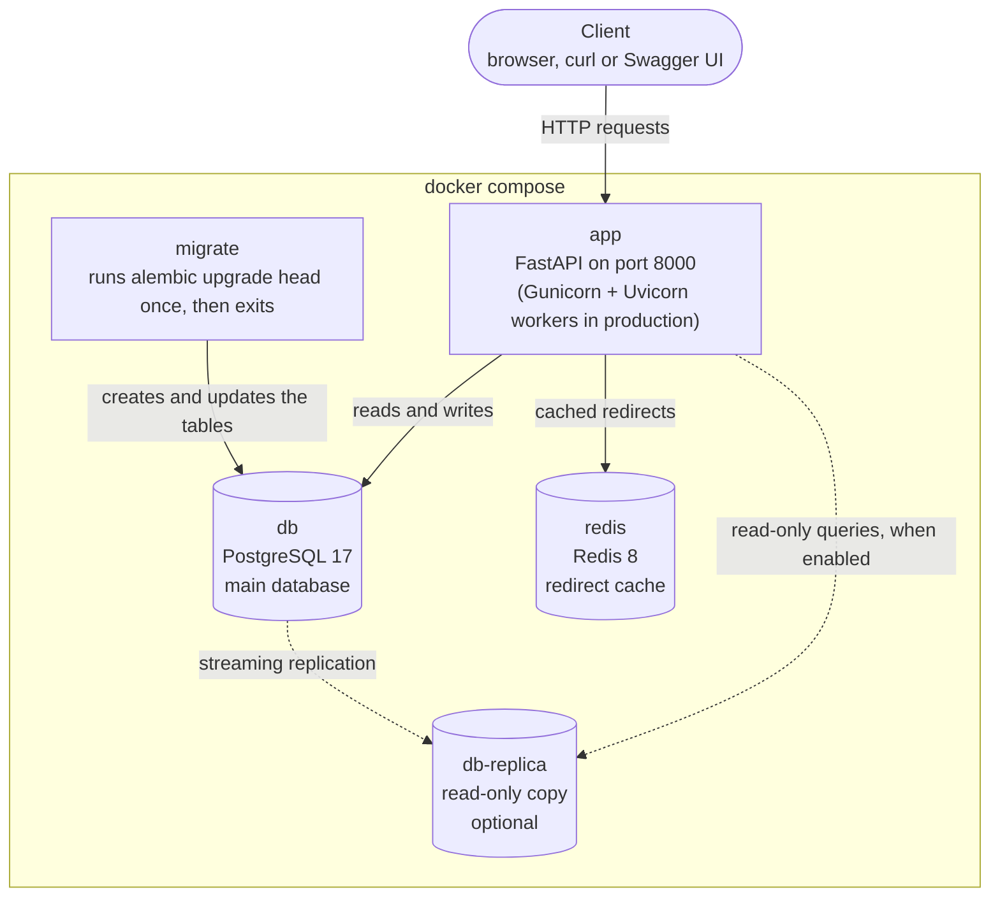
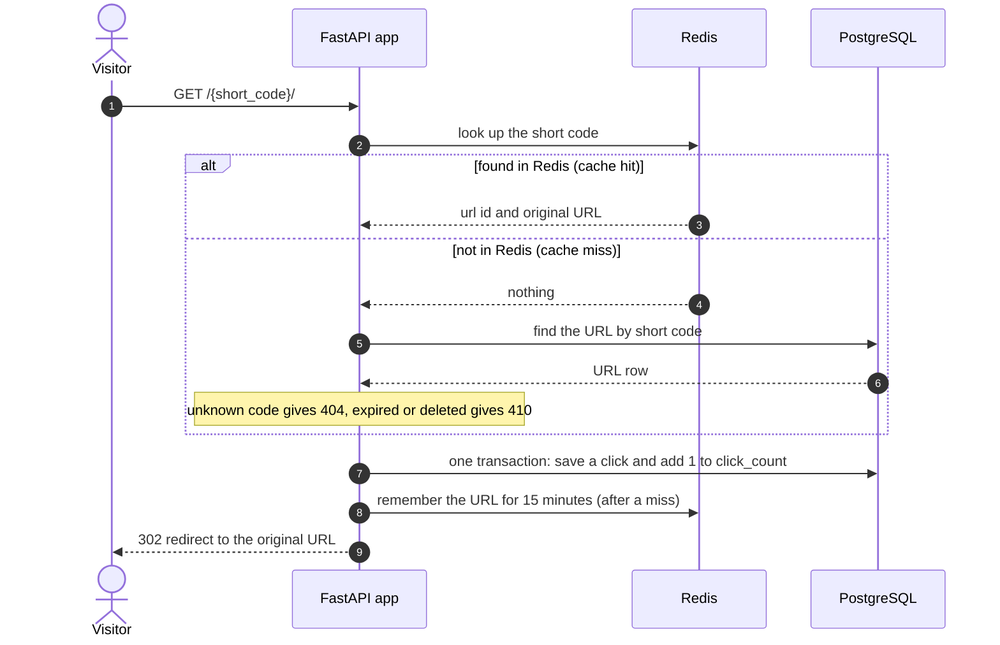
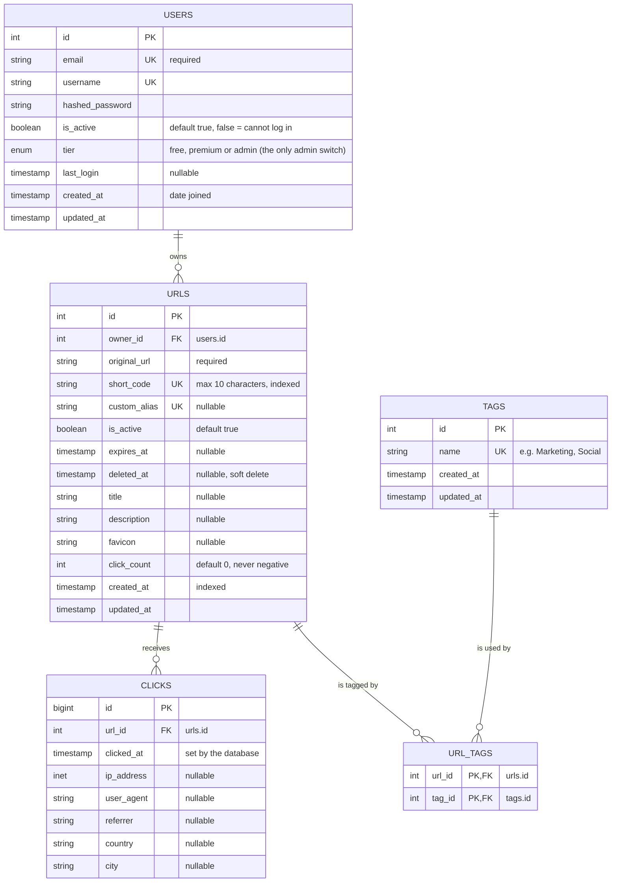

# URL Shortener

A URL shortening service (like Bitly): create short links with an optional custom alias,
expiry date and tags, get redirected when you open them, and see click analytics.

Built with **FastAPI** (approved by the instructor instead of Django), **async SQLAlchemy 2.0**,
**Alembic**, **PostgreSQL** and **Redis**.

## Architecture

### 1. Services (Docker Compose)



- **migrate** runs the database migrations first; the **app** starts only when they succeeded.
- **db** stores users, URLs, clicks and tags.
- **redis** remembers popular redirects for 15 minutes so the app can skip a database query.
  If Redis is down the app still works, just a bit slower.
- **db-replica** is optional: when it is enabled, read-only endpoints (list, details,
  analytics) use this copy and all writes go to **db**.

### 2. Inside the app (layers)


| Layer | Folder | Job |
|---|---|---|
| Routes | `app/api/routes` | Receive the request, validate it with a Pydantic schema, return the response |
| Schemas | `app/schemas` | Describe the JSON coming in and going out |
| Services | `app/services` | Business rules (expired, deleted, alias taken, ...) and the database transaction |
| Repositories | `app/repositories` | Every SQL query lives here, including ready-made ones like `active_urls()` |
| Models | `app/models` | The database tables, written with SQLAlchemy |

Each request gets its own database session through FastAPI dependencies
(`app/api/dependencies.py`), and the session is always closed at the end.

### 3. What happens when someone opens a short link



Saving the click and increasing the counter happen in **one transaction**: either both are
saved or neither is. The counter is increased inside the database
(`click_count = click_count + 1`), so two visits at the same moment are both counted.

## Data model



How to read it: `PK` = primary key, `FK` = foreign key (points to another table),
`UK` = unique. `||--o{` means **one to many**: one user owns many URLs.

| Relationship | Type | What happens on delete |
|---|---|---|
| users → urls | one user owns many URLs | deleting a user deletes their URLs |
| urls → clicks | one URL has many clicks | deleting a URL deletes its clicks |
| urls ↔ tags | many to many, through `url_tags` | deleting a URL or a tag removes only the link between them |

- A URL is **live** when it is active, not deleted and not expired; only live URLs redirect.
- Deleting a URL through the API is a **soft delete**: `deleted_at` is set, so its short code is
  never reused and its click history is kept.
- `is_premium` is **not a column**: it is a read-only property worked out from `tier`
  (premium and admin are premium), so the two can never disagree. A migration removed the
  old column; its downgrade rebuilds it from `tier`, so no data is lost either way.
- Six default tags (Marketing, Social, Email, Ads, Events, Personal) are added by a migration.

## Setup

### With Docker

```bash
docker compose up --build
```

This starts PostgreSQL, Redis, runs the database migrations, then starts the app.

- API docs (Swagger): <http://localhost:8000/docs>
- Health check: <http://localhost:8000/health>

Production mode (Gunicorn):

```bash
POSTGRES_PASSWORD=your-password docker compose -f docker-compose.prod.yml up --build
```

### Without Docker for the app

```bash
python -m venv .venv
.venv\Scripts\activate             # macOS/Linux: source .venv/bin/activate
pip install -r requirements-dev.txt
cp .env.example .env
# then set JWT_SECRET_KEY in .env to your own random value (32+ characters):
python -c "import secrets; print(secrets.token_urlsafe(48))"

docker compose up -d db redis      # PostgreSQL and Redis
alembic upgrade head               # create the tables
uvicorn app.main:app --reload
```

Settings are read from environment variables; see [.env.example](.env.example).
`JWT_SECRET_KEY` has **no default**: the app refuses to start if it is missing or shorter
than 32 characters, so a weak or public key can never sign tokens. `docker compose up` sets
a development-only value; `docker-compose.prod.yml` refuses to start without your own.

### Database commands

```bash
alembic upgrade head               # apply all migrations
alembic downgrade -1               # undo the last migration
python -m app.scripts.seed         # fill the database with sample data
```

## API endpoints

| Method | Endpoint | What it does | Who may call it |
|---|---|---|---|
| `POST` | `/api/v1/auth/register/` | Create an account (email + password) | Anyone |
| `POST` | `/api/v1/auth/login/` | Log in (OAuth2 form), get an access + refresh token | Anyone |
| `POST` | `/api/v1/auth/refresh/` | Swap a refresh token for a new token pair | Anyone with a refresh token |
| `GET` | `/api/v1/auth/me/` | The user of the access token | Logged in |
| `POST` | `/api/v1/urls/` | Create a short URL | Logged in. Free: at most 10 active URLs, no custom alias |
| `GET` | `/api/v1/urls/` | List URLs (cursor pages, filters) | Logged in: only your own URLs (also for an Admin) |
| `GET` | `/api/v1/urls/{short_code}/` | URL details (owner, tags, click count) | The owner or an Admin |
| `PUT` | `/api/v1/urls/{short_code}/` | Update a URL | The owner or an Admin |
| `DELETE` | `/api/v1/urls/{short_code}/` | Soft-delete a URL | The owner or an Admin |
| `GET` | `/api/v1/analytics/{short_code}/` | Click analytics (country, city, day, referrer) | Premium or Admin: own URLs (an Admin: any) |
| `GET` | `/{short_code}/` | Redirect to the original URL (302) | Anyone (public) |
| `GET` | `/health` | Database and cache status | Anyone |

### Tiers and permissions

Two different questions are checked, in this order:

1. **Who are you?** (authentication) The Bearer token. Missing or bad: `401`.
2. **May you do this?** (authorization) Not allowed: `403`.
   - **By tier** (role-based): FastAPI dependencies in `app/api/permissions.py`.
     `require_tier(...)` lets only the listed tiers through; `require_premium` = Premium or
     Admin. Analytics use it, so a Free user gets `403` before the short code is even looked
     at (and learns nothing about which codes exist).
   - **By ownership** (object-level): in `app/services/urls.py`, where the URL is loaded.
     Unknown or deleted code: `404`. Someone else's URL: `403`. An Admin may read, change and
     delete any URL; it stays the owner's.

| | Free | Premium | Admin |
|---|---|---|---|
| Active URLs (switched on, not deleted, not expired) | at most **10** | unlimited | unlimited |
| Custom alias | no (`403`) | yes | yes |
| Analytics | no (`403`) | own URLs | every URL |
| Manage other people's URLs | no | no | yes |

- The tier is read **from the database on every request**, never from the token, so a
  promotion or a downgrade counts at once. Tiers are changed only directly in the database:
  there is no public endpoint for it. A downgraded user keeps their URLs but cannot add a
  new one while they have more than 10 active.
- The limit belongs to the **account**, so every way to an 11th active URL is refused, not
  only creating one: switching an old URL back on, or giving an expired one a new date, is
  `403` too (even when an Admin makes the change). Editing a URL that stays active (title,
  tags, target) is always allowed.
- `owner_id`, `click_count` and `short_code` can never be sent (`422`): the owner always
  comes from the token.

### Log in

The URL and analytics endpoints need an **access token** (JWT). Each user only sees and
changes their own URLs. The redirect (`/{short_code}/`) and `/health` stay public.

```bash
# 1. Create an account: only email and password (8-128 characters) are needed.
#    The answer is {"id", "email", "tier"}; every account starts on the free tier.
curl -X POST http://localhost:8000/api/v1/auth/register/ \
  -H "Content-Type: application/json" \
  -d '{"email": "aline@example.com", "password": "a-long-passphrase"}'

# 2. Log in. It is the OAuth2 password flow, so it is a FORM, and the EMAIL goes in "username"
curl -X POST http://localhost:8000/api/v1/auth/login/ \
  -d "username=aline@example.com" -d "password=a-long-passphrase"
# -> {"access_token": "eyJ...", "refresh_token": "eyJ...", "token_type": "bearer"}

# 3. Send the access token with every request
TOKEN="eyJ..."   # the access_token from step 2
curl http://localhost:8000/api/v1/urls/ -H "Authorization: Bearer $TOKEN"

# 4. After 15 minutes the access token expires (401): get a new pair with the refresh token
curl -X POST http://localhost:8000/api/v1/auth/refresh/ \
  -H "Content-Type: application/json" -d '{"refresh_token": "eyJ..."}'
```

**In Swagger (`/docs`):**

1. Run **POST /api/v1/auth/register/** with your email and password.
2. Click the **Authorize** button (top right, the lock icon).
3. Type your **email in the `username` field** and your password; leave `client_id` and
   `client_secret` empty. Click **Authorize**, then **Close**.
4. Every request now sends `Authorization: Bearer <token>` (the lock icons are closed).
   Try **GET /api/v1/auth/me/**.
5. When a request answers `401` (after 15 minutes), click **Authorize** again: **Logout**,
   then log in again.

**How the tokens work:**

| | Access token | Refresh token |
|---|---|---|
| Used for | every API request (`Authorization: Bearer ...`) | only `POST /auth/refresh/` |
| Lives | 15 minutes (`ACCESS_TOKEN_MINUTES`) | 7 days (`REFRESH_TOKEN_DAYS`) |
| Contains | only `sub` (user id), `type`, `iat`, `exp`, `jti`: no email, no tier | the same five claims |

- Tokens are signed with **HS256** and `JWT_SECRET_KEY`. The server only accepts HS256
  (an `alg: none` or any other algorithm is refused) and checks `type`: an access token is
  refused at `/refresh/`, and a refresh token is refused everywhere else.
- The token only says **who** you are. Your tier and whether your account is active are read
  from the database on every request, so a promotion, a switch-off or a deletion counts at
  once, and a refresh token of a deleted or switched-off user gets nothing.
- There is **no logout endpoint**: tokens are stateless, so the server does not store them.
  A client logs out by forgetting its tokens; a stolen access token stops working after at
  most 15 minutes. Every token has a unique `jti`, ready for a server-side blocklist
  (Redis, planned for Module 8) if instant revocation is needed.
- Passwords are stored only as **Argon2id** hashes. They are Unicode-normalised (NFKC) first,
  so an accented password typed on any keyboard is the same password; spaces and letter case
  are kept exactly. Only ASCII emails are accepted, so a look-alike letter (such as a
  Cyrillic "a") cannot create an account that looks like someone else's.
- A wrong password, an unknown email and a switched-off account all get the **same** `401`,
  and an unknown email still runs one password check, so neither the answer nor the response
  time shows which emails are registered. (Registering with a taken email does answer `409`,
  as the specification asks.)
- Token responses send `Cache-Control: no-store`, so no browser or proxy keeps a copy.
- `username` is optional when registering: it is made from the email (`aline` from
  `aline@example.com`), with a random number added if that name is taken.

### Create a short URL

```bash
curl -X POST http://localhost:8000/api/v1/urls/ -H "Authorization: Bearer $TOKEN" \
  -H "Content-Type: application/json" \
  -d '{"original_url": "https://www.python.org/", "custom_alias": "python", "tags": ["Marketing"]}'
```

`custom_alias`, `expires_at` and `tags` are optional. `custom_alias` needs a Premium or
Admin account.

### List your URLs

```bash
curl "http://localhost:8000/api/v1/urls/?limit=20&sort=newest&tag=Marketing" \
  -H "Authorization: Bearer $TOKEN"
```

Optional filters: `tag`, `is_active`, `expired`, `search`. Sort: `newest` (has pages) or `most_clicked`
(one "top N" list without a next page: click counts change on every visit, so a cursor
on them would skip or repeat URLs; cursors are built only on `created_at` and `id`, which
never change).
Results are paginated: pass the returned `next_cursor` as `?cursor=...` to get the next page.

### Errors

All errors use the same format:

```json
{"error": {"code": "url_not_found", "message": "Short URL 'abc1234' was not found.", "details": {"short_code": "abc1234"}}}
```

Common status codes: `401` with a `WWW-Authenticate: Bearer` header (`not_authenticated`:
no token sent; `invalid_token`: bad, expired or wrong-type token; `invalid_credentials`:
wrong email or password), `403` not allowed (`forbidden`: someone else's URL;
`insufficient_tier`: a Premium feature; `free_tier_limit`: already 10 active URLs, with
`"details": {"limit": 10}`), `404` not found, `409` alias,
email or username already taken, `410` link expired or deleted, `422` invalid input
(also `redirect_loop`: an original URL pointing back to this shortener is refused, because
the short link would redirect to itself), `503` with `Retry-After` when Postgres cancelled
the request because of a conflicting one (deadlock): nothing was saved, so it is safe to
send again.

### Requests at the same moment

- **Same new tags, different order:** tags are always inserted in sorted order, so the second
  request waits its turn instead of deadlocking.
- **Two updates of one URL:** the update reads the URL with `SELECT ... FOR UPDATE`, so the
  second waits for the first and then starts from its result (no mixed tag lists).
- **The Free limit (check-then-act race):** "count the active URLs, then add one" would let
  two requests both count 9 and both add one (11). So every write that can add an active
  URL (create, switching on, a new expiry date) first locks the **owner's row**
  (`SELECT ... FOR UPDATE` on `users`) in the same transaction: the second request waits,
  then counts 10 and gets `403`. Tests run 6 creates at once on real Postgres connections
  and always end with exactly 10.
- **One lock order everywhere:** user row, then URL row, then tags (sorted). Redirects only
  lock the URL row. Requests never wait for each other in a circle, so they cannot deadlock.
- **A visit is not an edit:** counting a click keeps `updated_at` unchanged, and so does
  recording a login (`last_login`).
- **Two registrations with the same email:** the unique rule in Postgres decides, so the
  second one gets `409`, never a `500`. If two people's made-up usernames clash (both
  `aline`), the second simply gets `aline` plus a random number.
- **Login does not hold the database:** the slow password check runs after the read
  transaction is closed, so no pooled connection waits for it.
- **Cache vs. a change (cache-aside race):** a visitor may read a link from the database just
  before the owner deletes it and write it to Redis just after. To stop that late write,
  invalidating writes a 30-second "invalidated" marker (tombstone) and filling the cache uses
  `SET ... NX` (only if the key is empty), so the deleted link is never served from Redis.

## Tests

```bash
docker compose up -d db            # the tests need PostgreSQL
pytest                             # run all tests
pytest --cov                       # with a coverage report
```

Code quality (also run automatically on GitHub for every push):

```bash
ruff check .                       # lint, including docstrings
ruff format --check .              # formatting
mypy                               # type checking
```

## Project structure

```
app/
├── api/            # routes and dependencies
├── models/         # database models (User, URL, Click, Tag)
├── schemas/        # request and response models
├── repositories/   # database queries
├── services/       # business logic
├── cache/          # Redis redirect cache
├── core/           # settings, errors, logging
├── db/             # database connection
└── scripts/        # seed data
alembic/            # database migrations
tests/
```
