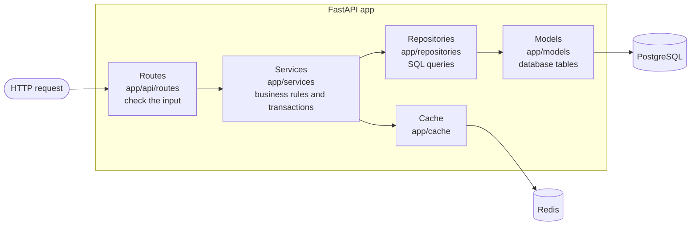
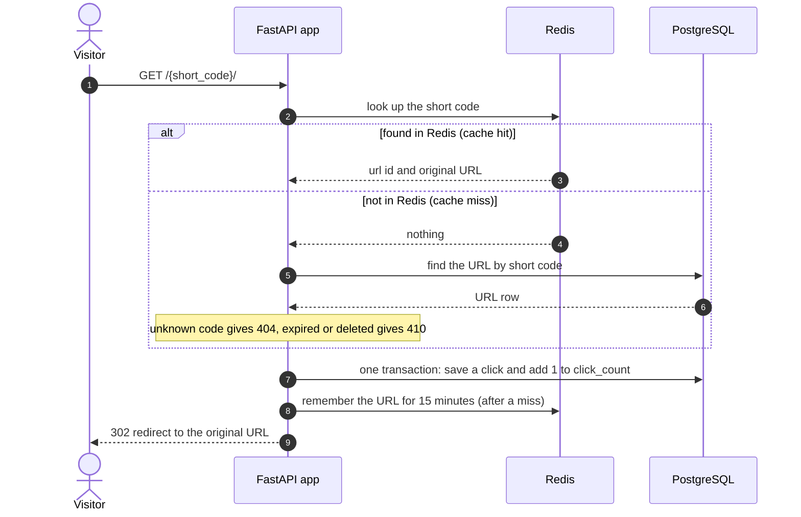
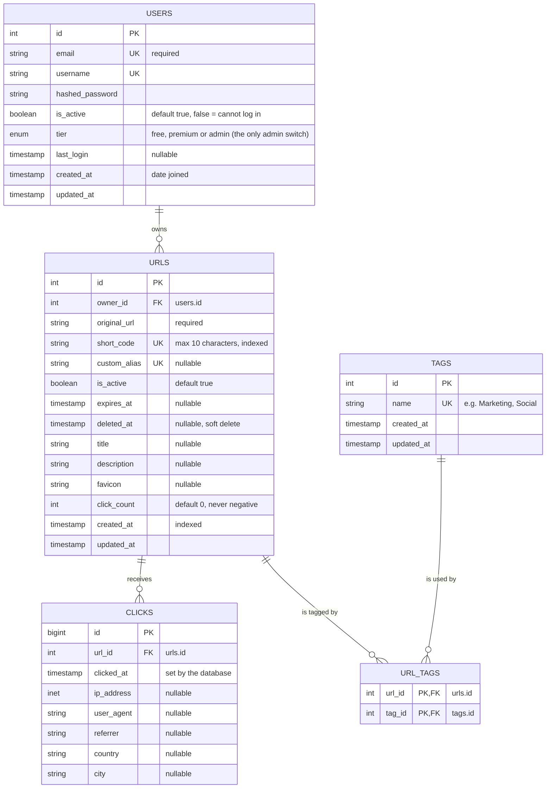
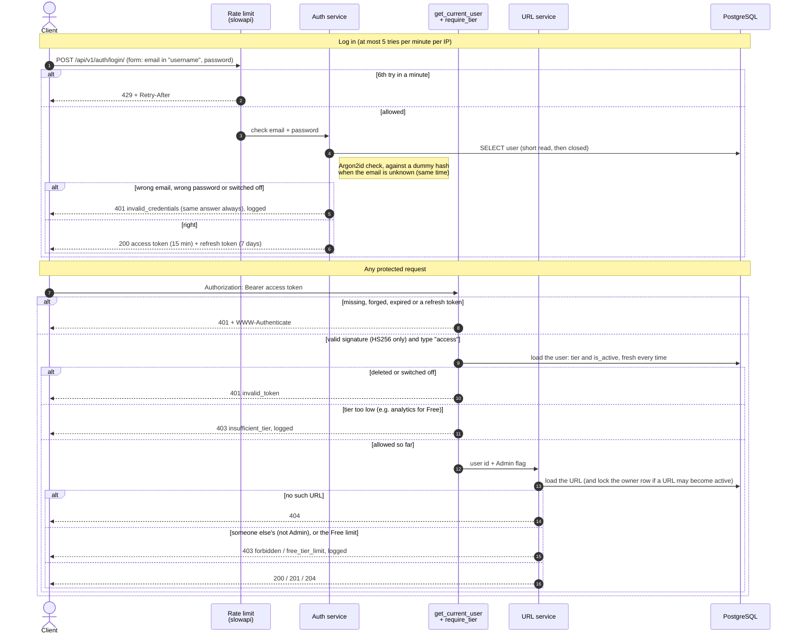

# URL Shortener

A URL shortening service (like Bitly): create short links with an optional custom alias,
expiry date and tags, get redirected when you open them, and see click analytics.

Built with **FastAPI** (approved by the instructor instead of Django), **async SQLAlchemy 2.0**,
**Alembic**, **PostgreSQL** and **Redis**.

## Architecture

### 1. Services (Docker Compose)


- **migrate** runs the database migrations first; the **app** starts only when they succeeded.
- **db** stores users, URLs, clicks and tags.
- **redis** remembers popular redirects for 15 minutes so the app can skip a database query.
  If Redis is down the app still works, just a bit slower.
- **db-replica** is optional: when it is enabled, read-only endpoints (list, details,
  analytics) use this copy and all writes go to **db**.

### 2. Inside the app (layers)



| Layer | Folder | Job |
|---|---|---|
| Routes | `app/api/routes` | Receive the request, validate it with a Pydantic schema, return the response |
| Schemas | `app/schemas` | Describe the JSON coming in and going out |
| Services | `app/services` | Business rules (expired, deleted, alias taken, ...) and the database transaction |
| Repositories | `app/repositories` | Every SQL query lives here, including ready-made ones like `active_urls()` |
| Models | `app/models` | The database tables, written with SQLAlchemy |

Each request gets its own database session through FastAPI dependencies
(`app/api/dependencies.py`), and the session is always closed at the end.

### 3. What happens when someone opens a short link



Saving the click and increasing the counter happen in **one transaction**: either both are
saved or neither is. The counter is increased inside the database
(`click_count = click_count + 1`), so two visits at the same moment are both counted.

## Data model



How to read it: `PK` = primary key, `FK` = foreign key (points to another table),
`UK` = unique. `||--o{` means **one to many**: one user owns many URLs.

| Relationship | Type | What happens on delete |
|---|---|---|
| users → urls | one user owns many URLs | deleting a user deletes their URLs |
| urls → clicks | one URL has many clicks | deleting a URL deletes its clicks |
| urls ↔ tags | many to many, through `url_tags` | deleting a URL or a tag removes only the link between them |

- A URL is **live** when it is active, not deleted and not expired; only live URLs redirect.
- Deleting a URL through the API is a **soft delete**: `deleted_at` is set, so its short code is
  never reused and its click history is kept.
- `is_premium` is **not a column**: it is a read-only property worked out from `tier`
  (premium and admin are premium), so the two can never disagree. A migration removed the
  old column; its downgrade rebuilds it from `tier`, so no data is lost either way.
- Six default tags (Marketing, Social, Email, Ads, Events, Personal) are added by a migration.

## Setup

### With Docker

```bash
docker compose up --build
```

This starts PostgreSQL, Redis, runs the database migrations, then starts the app.

- API docs (Swagger): <http://localhost:8000/docs>
- Health check: <http://localhost:8000/health>

Production mode (Gunicorn):

```bash
POSTGRES_PASSWORD=your-password docker compose -f docker-compose.prod.yml up --build
```

### Without Docker for the app

```bash
python -m venv .venv
.venv\Scripts\activate             # macOS/Linux: source .venv/bin/activate
pip install -r requirements-dev.txt
cp .env.example .env
# then set JWT_SECRET_KEY in .env to your own random value (32+ characters):
python -c "import secrets; print(secrets.token_urlsafe(48))"

docker compose up -d db redis      # PostgreSQL and Redis
alembic upgrade head               # create the tables
uvicorn app.main:app --reload
```

Settings are read from environment variables; see [.env.example](.env.example).
`JWT_SECRET_KEY` has **no default**: the app refuses to start if it is missing or shorter
than 32 characters, so a weak or public key can never sign tokens. `docker compose up` sets
a development-only value; `docker-compose.prod.yml` refuses to start without your own.

### Database commands

```bash
alembic upgrade head               # apply all migrations
alembic downgrade -1               # undo the last migration
python -m app.scripts.seed         # fill the database with sample data
```

## API endpoints

| Method | Endpoint | What it does | Who may call it |
|---|---|---|---|
| `POST` | `/api/v1/auth/register/` | Create an account (email + password); `202`, the same answer for every email | Anyone; at most 10 per hour per client (`429`) |
| `POST` | `/api/v1/auth/login/` | Log in (OAuth2 form), get an access + refresh token | Anyone; at most 5 tries per minute per IP (`429`) |
| `POST` | `/api/v1/auth/refresh/` | Swap a refresh token for a new token pair (each refresh token works once) | Anyone with a refresh token |
| `GET` | `/api/v1/auth/me/` | The user of the access token | Logged in |
| `POST` | `/api/v1/urls/` | Create a short URL | Logged in; at most 30 per minute per user (`429`). Free: at most 10 active URLs, no custom alias |
| `GET` | `/api/v1/urls/` | List URLs (cursor pages, filters) | Logged in: only your own URLs (also for an Admin) |
| `GET` | `/api/v1/urls/{short_code}/` | URL details (owner, tags, click count) | The owner or an Admin |
| `PUT` | `/api/v1/urls/{short_code}/` | Update a URL | The owner or an Admin |
| `DELETE` | `/api/v1/urls/{short_code}/` | Soft-delete a URL | The owner or an Admin |
| `GET` | `/api/v1/analytics/{short_code}/` | Click analytics (country, city, day, referrer) | Premium or Admin: own URLs (an Admin: any) |
| `GET` | `/{short_code}/` | Redirect to the original URL (302) | Anyone (public) |
| `GET` | `/health` | Database and cache status | Anyone |

### Tiers and permissions

Two different questions are checked, in this order:

1. **Who are you?** (authentication) The Bearer token. Missing or bad: `401`.
2. **May you do this?** (authorization) Not allowed: `403`.
   - **By tier** (role-based): FastAPI dependencies in `app/api/permissions.py`.
     `require_tier(...)` lets only the listed tiers through; `require_premium` = Premium or
     Admin. Analytics use it, so a Free user gets `403` before the short code is even looked
     at (and learns nothing about which codes exist).
   - **By ownership** (object-level): in `app/services/urls.py`, where the URL is loaded.
     Unknown or deleted code: `404`. Someone else's URL: `403`. An Admin may read, change and
     delete any URL; it stays the owner's.

| | Free | Premium | Admin |
|---|---|---|---|
| Active URLs (switched on, not deleted, not expired) | at most **10** | unlimited | unlimited |
| Custom alias | no (`403`) | yes | yes |
| Analytics | no (`403`) | own URLs | every URL |
| Manage other people's URLs | no | no | yes |

- The tier is read **from the database on every request**, never from the token, so a
  promotion or a downgrade counts at once. Tiers are changed only directly in the database:
  there is no public endpoint for it. A downgraded user keeps their URLs but cannot add a
  new one while they have more than 10 active.
- The limit belongs to the **account**, so every way to an 11th active URL is refused, not
  only creating one: switching an old URL back on, or giving an expired one a new date, is
  `403` too (even when an Admin makes the change). Editing a URL that stays active (title,
  tags, target) is always allowed.
- `owner_id`, `click_count` and `short_code` can never be sent (`422`): the owner always
  comes from the token.

### Log in

The URL and analytics endpoints need an **access token** (JWT). Each user only sees and
changes their own URLs. The redirect (`/{short_code}/`) and `/health` stay public.

```bash
# 1. Create an account: only email and password (8-128 characters) are needed.
#    The answer is 202 {"message": ...} whether the email is new or already taken
#    (so nobody can find out which emails exist); accounts start on the free tier.
curl -X POST http://localhost:8000/api/v1/auth/register/ \
  -H "Content-Type: application/json" \
  -d '{"email": "aline@example.com", "password": "a-long-passphrase"}'

# 2. Log in. It is the OAuth2 password flow, so it is a FORM, and the EMAIL goes in "username"
curl -X POST http://localhost:8000/api/v1/auth/login/ \
  -d "username=aline@example.com" -d "password=a-long-passphrase"
# -> {"access_token": "eyJ...", "refresh_token": "eyJ...", "token_type": "bearer"}

# 3. Send the access token with every request
TOKEN="eyJ..."   # the access_token from step 2
curl http://localhost:8000/api/v1/urls/ -H "Authorization: Bearer $TOKEN"

# 4. After 15 minutes the access token expires (401): get a new pair with the refresh token
curl -X POST http://localhost:8000/api/v1/auth/refresh/ \
  -H "Content-Type: application/json" -d '{"refresh_token": "eyJ..."}'
```

**In Swagger (`/docs`):**

1. Run **POST /api/v1/auth/register/** with your email and password.
2. Click the **Authorize** button (top right, the lock icon).
3. Type your **email in the `username` field** and your password; leave `client_id` and
   `client_secret` empty. Click **Authorize**, then **Close**.
4. Every request now sends `Authorization: Bearer <token>` (the lock icons are closed).
   Try **GET /api/v1/auth/me/**.
5. When a request answers `401` (after 15 minutes), click **Authorize** again: **Logout**,
   then log in again.

**How the tokens work:**

| | Access token | Refresh token |
|---|---|---|
| Used for | every API request (`Authorization: Bearer ...`) | only `POST /auth/refresh/` |
| Lives | 15 minutes (`ACCESS_TOKEN_MINUTES`) | 7 days (`REFRESH_TOKEN_DAYS`) |
| Contains | only `sub` (user id), `type`, `iat`, `exp`, `jti`: no email, no tier | the same five claims |

- Tokens are signed with **HS256** and `JWT_SECRET_KEY`. The server only accepts HS256
  (an `alg: none` or any other algorithm is refused) and checks `type`: an access token is
  refused at `/refresh/`, and a refresh token is refused everywhere else.
- The token only says **who** you are. Your tier and whether your account is active are read
  from the database on every request, so a promotion, a switch-off or a deletion counts at
  once, and a refresh token of a deleted or switched-off user gets nothing.
- **Every refresh token works once (rotation), and a reused one revokes them all (reuse
  detection).** The server stores each refresh token's id (`jti`, never the token itself) in
  the `refresh_tokens` table. A refresh marks it used in one atomic `UPDATE ... WHERE used_at
  IS NULL`, so two refreshes with the same token can never both succeed. If an already used
  refresh token comes back, someone kept a copy: thief and user cannot be told apart, so
  every refresh token of that account is deleted and both must log in again (logged as a
  security event).
- **Every token of an account can be revoked at once.** `users.tokens_valid_after` is a
  moment in time: every access or refresh token issued before it is refused. A refresh-token
  reuse sets it to "now", so a thief's access token stops working immediately, not 15
  minutes later. Token `iat` times are exact (fractions of a second, as RFC 7519 allows) and
  come from the app's clock, so a token issued a moment before is refused and a login a
  moment after works. It is checked on the user row every request loads anyway: no extra
  query. There is no logout endpoint (a client logs out by forgetting its tokens).
- Passwords are stored only as **Argon2id** hashes. They are Unicode-normalised (NFKC) first,
  so an accented password typed on any keyboard is the same password; spaces and letter case
  are kept exactly. Only ASCII emails are accepted, so a look-alike letter (such as a
  Cyrillic "a") cannot create an account that looks like someone else's.
- A wrong password, an unknown email and a switched-off account all get the **same** `401`,
  and an unknown email still runs one password check, so neither the answer nor the response
  time shows which emails are registered.
- **Register reveals nothing either**: it answers `202` with the same message whether the
  email is new or already registered, runs the same slow password hash in both cases (same
  response time), and never changes an existing account. Taken emails are logged (masked),
  so an admin can see someone checking many emails. This **deliberately replaces brief
  tests #1 and #4** (`201` with `id`, `email`, `tier`, and `409` for a taken email): both
  answers would tell an attacker that the email is registered. After logging in,
  `GET /auth/me/` shows the account. A chosen `username` that is taken still answers `409`
  (usernames are public, and that check runs only for a new email).
- Token responses send `Cache-Control: no-store`, so no browser or proxy keeps a copy.
- `username` is optional when registering: it is made from the email (`aline` from
  `aline@example.com`), with a random number added if that name is taken.

### Create a short URL

```bash
curl -X POST http://localhost:8000/api/v1/urls/ -H "Authorization: Bearer $TOKEN" \
  -H "Content-Type: application/json" \
  -d '{"original_url": "https://www.python.org/", "custom_alias": "python", "tags": ["Marketing"]}'
```

`custom_alias`, `expires_at` and `tags` are optional. `custom_alias` needs a Premium or
Admin account.

### List your URLs

```bash
curl "http://localhost:8000/api/v1/urls/?limit=20&sort=newest&tag=Marketing" \
  -H "Authorization: Bearer $TOKEN"
```

Optional filters: `tag`, `is_active`, `expired`, `search`. Sort: `newest` (has pages) or `most_clicked`
(one "top N" list without a next page: click counts change on every visit, so a cursor
on them would skip or repeat URLs; cursors are built only on `created_at` and `id`, which
never change).
Results are paginated: pass the returned `next_cursor` as `?cursor=...` to get the next page.

### Errors

All errors use the same format:

```json
{"error": {"code": "url_not_found", "message": "Short URL 'abc1234' was not found.", "details": {"short_code": "abc1234"}}}
```

Common status codes: `401` with a `WWW-Authenticate: Bearer` header (`not_authenticated`:
no token sent; `invalid_token`: bad, expired or wrong-type token; `invalid_credentials`:
wrong email or password), `403` not allowed (`forbidden`: someone else's URL;
`insufficient_tier`: a Premium feature; `free_tier_limit`: already 10 active URLs, with
`"details": {"limit": 10}`), `404` not found, `409` alias,
email or username already taken, `410` link expired or deleted, `422` invalid input
(also `redirect_loop`: an original URL pointing back to this shortener is refused, because
the short link would redirect to itself), `429` too many login attempts (with
`Retry-After`), `503` with `Retry-After` when Postgres cancelled
the request because of a conflicting one (deadlock): nothing was saved, so it is safe to
send again.

### Requests at the same moment

- **Same new tags, different order:** tags are always inserted in sorted order, so the second
  request waits its turn instead of deadlocking.
- **Two updates of one URL:** the update reads the URL with `SELECT ... FOR UPDATE`, so the
  second waits for the first and then starts from its result (no mixed tag lists).
- **The Free limit (check-then-act race):** "count the active URLs, then add one" would let
  two requests both count 9 and both add one (11). So every write that can add an active
  URL (create, switching on, a new expiry date) first locks the **owner's row**
  (`SELECT ... FOR UPDATE` on `users`) in the same transaction: the second request waits,
  then counts 10 and gets `403`. Tests run 6 creates at once on real Postgres connections
  and always end with exactly 10.
- **One lock order everywhere:** user row, then URL row, then tags (sorted). Redirects only
  lock the URL row. Requests never wait for each other in a circle, so they cannot deadlock.
- **A visit is not an edit:** counting a click keeps `updated_at` unchanged, and so does
  recording a login (`last_login`).
- **Two registrations with the same email:** the unique rule in Postgres decides, so only
  one account is created and the second request gets the same quiet `202`, never a `500`. If two people's made-up usernames clash (both
  `aline`), the second simply gets `aline` plus a random number.
- **Login does not hold the database:** the slow password check runs after the read
  transaction is closed, so no pooled connection waits for it.
- **Cache vs. a change (cache-aside race):** a visitor may read a link from the database just
  before the owner deletes it and write it to Redis just after. To stop that late write,
  invalidating writes a 30-second "invalidated" marker (tombstone) and filling the cache uses
  `SET ... NX` (only if the key is empty), so the deleted link is never served from Redis.

## Security

### How one request is checked



### What protects what (OWASP Top 10, 2025)

| Risk | How this app handles it |
|---|---|
| A01 Broken Access Control | Ownership checked on every URL (`403`), Admin override, tier dependencies, `owner_id` only from the token, the list shows only your URLs |
| A02 Security Misconfiguration | `JWT_SECRET_KEY` required (32+ characters), `DEBUG` never shows stack traces, `nosniff` and `X-Frame-Options: DENY` on every response, the database has no public port in production |
| A03 Software Supply Chain Failures | Every package pinned in `requirements.txt`; CI runs `pip-audit` on every push, pull request and every Monday (fails on any known vulnerability); Dependabot opens weekly update PRs for packages, GitHub Actions and the Docker image; GitGuardian scans every pull request for secrets |
| A04 Cryptographic Failures | Argon2id password hashes with a salt, HS256 tokens with a long random key, token responses are `no-store` |
| A05 Injection | SQL only through SQLAlchemy (bound parameters), only `http`/`https` links (`javascript:` and `data:` are `422`), line breaks never reach the `Location` header, client text is cleaned before it is logged |
| A06 Insecure Design | The Free limit is locked (`SELECT ... FOR UPDATE`), one lock order (no deadlocks), tested with real concurrent requests |
| A07 Authentication Failures | Login and register rate limits (sliding window, one bucket per IPv4 address or IPv6 /64), a per-account limit on failed logins (stops botnets), counters in Redis shared by all workers, one answer for every failed login, dummy-hash timing (also for accounts without a password), short access tokens, refresh tokens that work once with reuse detection, every token revocable at once (`tokens_valid_after`), the `type` claim, `alg: none` refused |
| A08 Software or Data Integrity Failures | Every token is signature-checked with a fixed algorithm list; tier and active status come from the database, never from the token |
| A09 Security Logging and Alerting Failures | `app.security` logs failed logins (masked email + IP), every `403` (code, path, user id, IP) and rate-limit hits; never a password, token or `Authorization` header |
| A10 Mishandling of Exceptional Conditions | Unknown errors: a plain `500` with a request id (details only in the server log); deadlocks: `503` + `Retry-After`; every token or permission doubt fails closed (`401`/`403`) |

The web Top 10 has editions for 2017, 2021 and 2025 (the next is expected around
2028). The 2021 list has the same risks under older names; its A10 Server-Side Request
Forgery is part of A01 in 2025 and is covered below (API7).

### What protects what (OWASP API Security Top 10, 2023)

For an API this list fits even better than the web Top 10.

| Risk | How this app handles it |
|---|---|
| API1 Broken Object Level Authorization | Every URL and analytics request checks the owner (`403`), Admin excepted; tested for read, update, switch-on and delete |
| API2 Broken Authentication | See A07 above |
| API3 Broken Object Property Level Authorization | `extra="forbid"` on every input (no `tier`, `owner_id`, `click_count`, `short_code`); responses never contain the password hash, and a URL shows only its owner's id and username |
| API4 Unrestricted Resource Consumption | Rate limits on login (per client and per account), register (per client) and creating URLs (per user), counted in Redis so every worker shares them; 64 KB body limit; page size at most 100; password hashing in a pool of 4 threads |
| API5 Broken Function Level Authorization | Tier checks as dependencies (`require_tier`, `require_premium`): analytics and custom aliases need Premium or Admin |
| API6 Unrestricted Access to Sensitive Business Flows | Mass link creation (spam, phishing) is limited to 30 new URLs per minute per user, whatever the network, and deleting does not give the budget back |
| API7 Server-Side Request Forgery | The server never fetches the original URLs (the visitor's browser follows the redirect). Module 9 previews will need a check for internal addresses |
| API8 Security Misconfiguration | See A02 above |
| API9 Improper Inventory Management | One versioned API (`/api/v1`), every endpoint in Swagger and in the table above |
| API10 Unsafe Consumption of APIs | The app calls no outside APIs today (Module 9 will) |

### What is checked on input

- `original_url`: `http` or `https` only, at most 2048 characters, no `user:password@` inside
  (it would be shown to every visitor; `https://google.com@evil.example` is a phishing trick),
  and never one of our own hosts (`BASE_URL`'s host plus `OWN_HOSTS`, compared lower-case and
  without a trailing dot), because the link would redirect to itself.
- `custom_alias`: 3-10 characters of `A-Z a-z 0-9 _ -`; reserved names (`api`, `docs`,
  `redoc`, `openapi`, `openapi.json`, `admin`, `health`, `static`, in any letter case) are `422`;
  a taken alias is `409`.
- Unknown fields are refused (`422`) everywhere, so nobody can send `tier`, `owner_id`,
  `click_count` or `short_code`.
- Text that goes to the database may not contain a NUL character (PostgreSQL cannot store
  it); tag names and titles may not contain control or invisible characters at all;
  `description` is at most 2000 characters.
- Request bodies over 64 KB are refused with `413` (the largest real one is under 10 KB).
- A forged pagination cursor (an impossible id or date) is `400 invalid_cursor`.
- Strange user ids inside a signed token (`007`, numbers too big for the database) are `401`.
  Server clocks may differ by up to 30 seconds without fresh tokens being refused.
- Password hashing runs in a small pool of 4 threads per worker: a flood of logins or
  registrations waits its turn instead of using 64 MB per request at once. A taken email is
  refused before any hashing.
- Logs never contain raw client text: paths, emails and request ids are cleaned, so a
  client cannot forge a log line or hide terminal escape codes in it.

### Known limits (and what production needs)

- **Rate-limit counters live in Redis** whenever Redis is configured (`REDIS_URL`, or
  `RATE_LIMIT_STORAGE_URI`): one count shared by every Gunicorn worker and kept across
  restarts. This goes beyond the brief, which asked for in-memory storage with Redis in
  Module 8. If Redis stops answering, the limits keep counting in each worker's memory
  (so briefly "5" can mean "5 per worker") and switch back once Redis answers; a dead Redis
  never causes a 500 (0.5 s connect and read timeouts). Measured on the production image
  with 2 workers: Redis up, the 429 comes at exactly the 6th login every time; Redis
  stopped, no errors and the limits still apply. One cost remains: slowapi talks to Redis
  synchronously, and when the Redis host name cannot be resolved (a stopped container),
  the first request on each worker waits about 3 s for the DNS lookup while the others
  answer in milliseconds. An async limiter (the `limits` library's `async+redis://`
  storage) would remove that; a Module 8 improvement.
- **Failed logins are also limited per account** (`LOGIN_ACCOUNT_RATE_LIMIT`, 10 per hour,
  from any address), which stops a botnet. Trade-off: anyone who knows an email can use up
  its budget, so the owner may have to wait up to an hour; logins are slowed, the account is
  never locked for good. The counters hold a keyed hash (HMAC) of the email, never the email.
- **Behind a reverse proxy**, every client has the proxy's IP (and one client could lock
  everyone out of login) unless `FORWARDED_ALLOW_IPS` is set to the proxy's address: then
  Gunicorn trusts `X-Forwarded-For` from that proxy only. The app itself never reads
  `X-Forwarded-For`: anyone can fake it.
- **Someone who registers with an email that is already taken** gets the same "OK" as
  anyone else and can then not log in with their new password, with no explanation. Real
  systems email the address's owner instead; this app sends no email (a later module).
- **Tags are shared by everyone** (Module 6 design): a new URL gets the tag's first spelling
  ("Marketing"), which shows that someone already used that tag name. Tag names are not secret.
- **Switching a user off** stops their tokens at once, but their short links keep redirecting
  (a product decision: links already shared keep working).
- **HTTPS** must be provided by the server or proxy in front of the app.
- **Package hashes are not pinned**: versions are exact, but the downloaded files are not
  checked against a hash. `pip-compile --generate-hashes` would add that (a next step for
  the supply chain). Dependabot only starts once this code is on `main`, and its security
  updates need "Dependabot security updates" switched on in the GitHub repository settings.
- **Module 9** (URL previews) will fetch original URLs from the server: it will need its own
  protection against links to internal addresses (`127.0.0.1`, `[::1]`, private networks).

## Tests

```bash
docker compose up -d db            # the tests need PostgreSQL
pytest                             # run all tests
pytest --cov                       # with a coverage report
```

Code quality (also run automatically on GitHub for every push):

```bash
ruff check .                       # lint, including docstrings
ruff format --check .              # formatting
mypy                               # type checking
```

## Project structure

```
app/
├── api/            # routes and dependencies
├── models/         # database models (User, URL, Click, Tag)
├── schemas/        # request and response models
├── repositories/   # database queries
├── services/       # business logic
├── cache/          # Redis redirect cache
├── core/           # settings, errors, logging
├── db/             # database connection
└── scripts/        # seed data
alembic/            # database migrations
tests/
```
