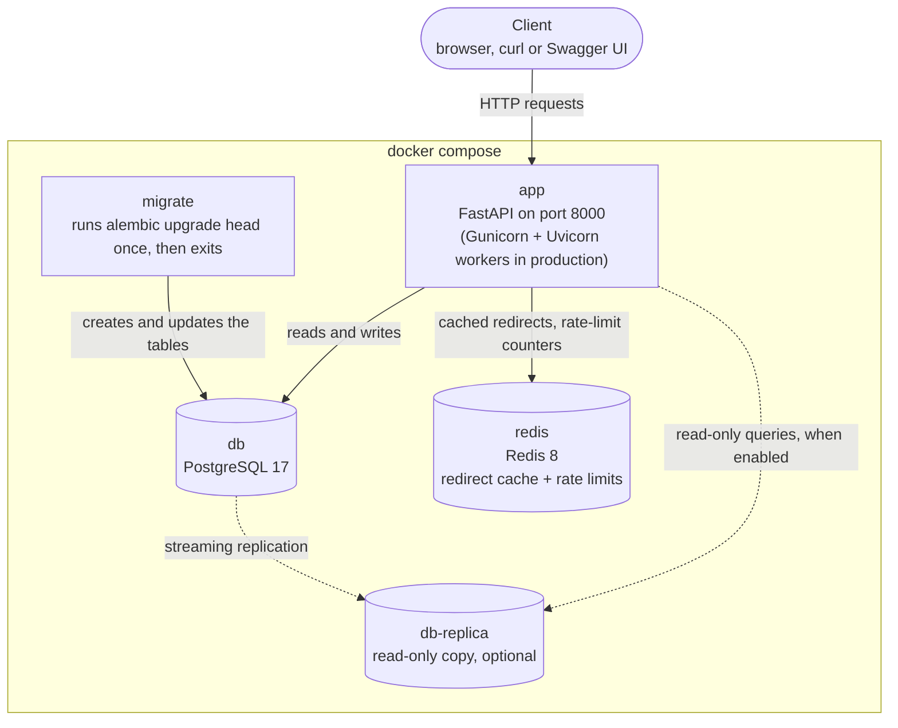
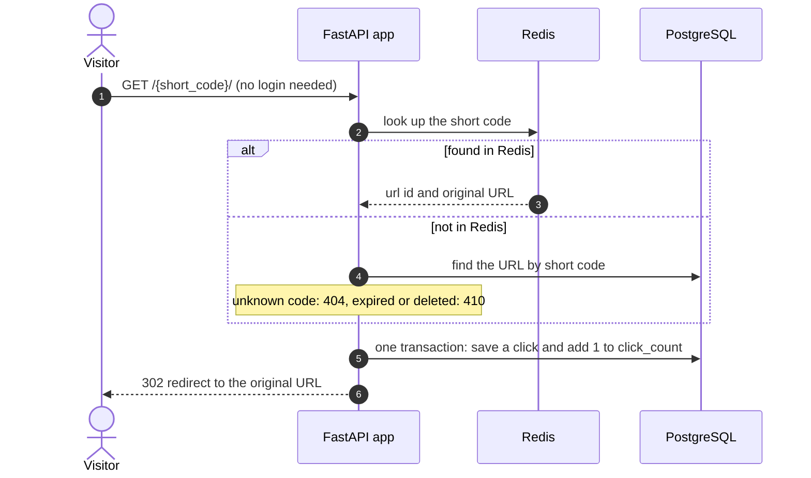
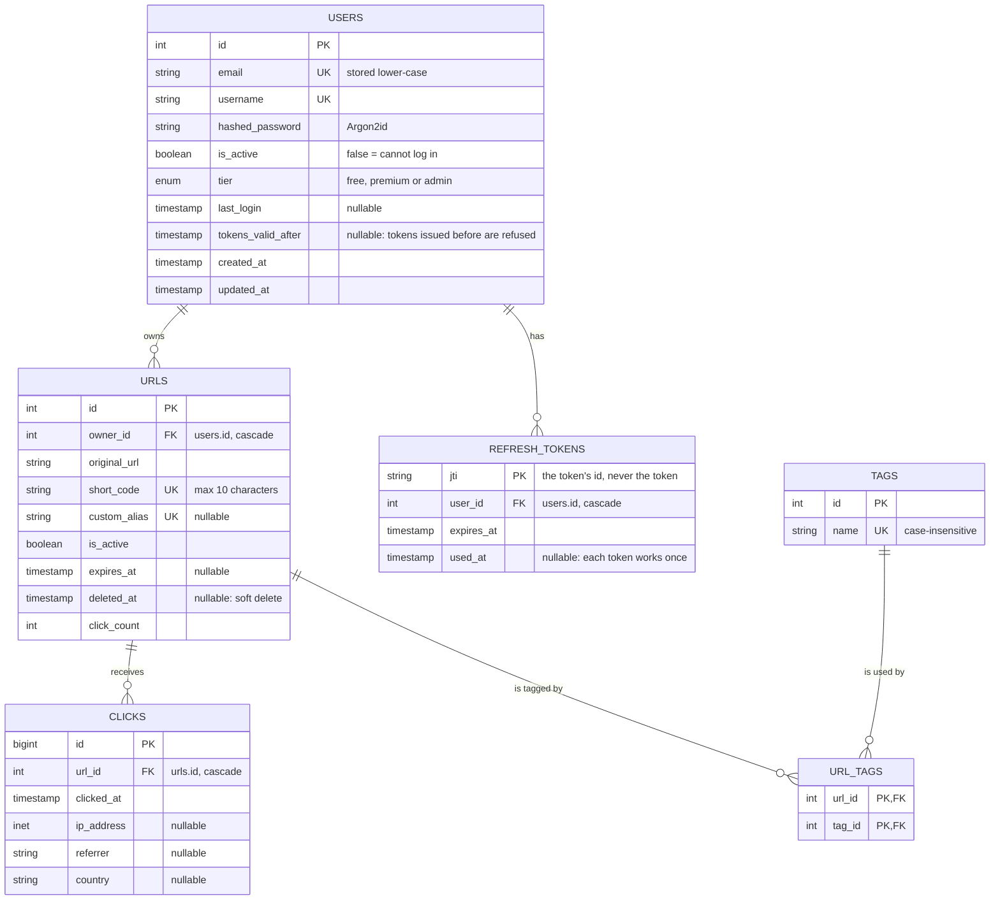
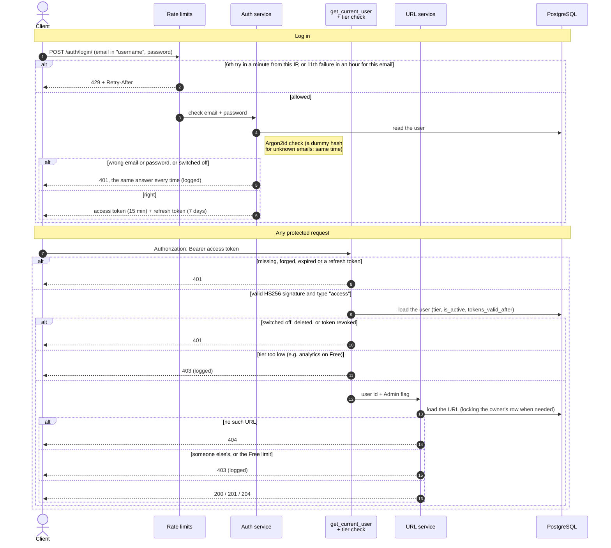

# URL Shortener

A URL shortening service (like Bitly): create short links with an optional custom alias,
expiry date and tags, follow them to be redirected, and see click analytics. Users log in
with JWT tokens, and what they may do depends on their tier (Free, Premium or Admin).

Built with **FastAPI** (approved by the instructor instead of Django + DRF),
**async SQLAlchemy 2.0**, **Alembic**, **PostgreSQL** and **Redis**.

## Quick start

### With Docker

```bash
docker compose up --build
```

This starts PostgreSQL and Redis, runs the database migrations, then starts the app.

- API docs (Swagger): <http://localhost:8000/docs>
- Health check: <http://localhost:8000/health>

Production mode (Gunicorn with several workers):

```bash
POSTGRES_PASSWORD=... JWT_SECRET_KEY=... docker compose -f docker-compose.prod.yml up --build
```

### Without Docker for the app

```bash
python -m venv .venv
.venv\Scripts\activate             # macOS/Linux: source .venv/bin/activate
pip install -r requirements-dev.txt
cp .env.example .env               # then set JWT_SECRET_KEY (see Configuration)

docker compose up -d db redis      # PostgreSQL and Redis
alembic upgrade head               # create the tables
uvicorn app.main:app --reload
```

### Database commands

```bash
alembic upgrade head               # apply all migrations
alembic downgrade -1               # undo the last migration
python -m app.scripts.seed         # fill the database with sample data
```

## Configuration

Settings are read from environment variables (or `.env`); see [.env.example](.env.example).

| Variable | Default | Meaning |
|---|---|---|
| `JWT_SECRET_KEY` | **none (required)** | Signs the tokens. The app refuses to start if it is missing or shorter than 32 characters. Create one: `python -c "import secrets; print(secrets.token_urlsafe(48))"` |
| `ACCESS_TOKEN_MINUTES` / `REFRESH_TOKEN_DAYS` | `15` / `7` | Token lifetimes |
| `LOGIN_RATE_LIMIT` | `5/minute` | Login attempts per client IP |
| `LOGIN_ACCOUNT_RATE_LIMIT` | `10/hour` | Failed logins per account (email), from any IP |
| `REGISTER_RATE_LIMIT` | `10/hour` | Registrations per client IP |
| `CREATE_URL_RATE_LIMIT` | `30/minute` | New short URLs per user |
| `RATE_LIMIT_STORAGE_URI` | empty | Where rate-limit counters live. Empty = `REDIS_URL` if set, else in memory |
| `REDIS_URL` | empty | Redis for the redirect cache and the rate limits |
| `BASE_URL` / `OWN_HOSTS` | `http://localhost:8000` / empty | This shortener's own host names: short links may not point to them |
| `FORWARDED_ALLOW_IPS` | `127.0.0.1` | Behind a reverse proxy: the proxy's IP, so the real client IP is used |

`docker compose up` sets a development-only `JWT_SECRET_KEY`; `docker-compose.prod.yml`
refuses to start without your own.

## Architecture

### Services (Docker Compose)



- **migrate** runs the database migrations first; the **app** starts only when they succeeded.
- **redis** caches popular redirects and holds the rate-limit counters (shared by all
  workers). If Redis is down the app still works: redirects come from the database and the
  rate limits count in memory.
- **db-replica** is optional: when enabled, read-only endpoints use it.

### Inside the app (layers)

| Layer | Folder | Job |
|---|---|---|
| Routes | `app/api/routes` | Receive the request, validate it, return the response |
| Auth and permissions | `app/api/auth.py`, `app/api/permissions.py` | Who is calling (Bearer token) and which tier they need |
| Schemas | `app/schemas` | The JSON coming in and going out (Pydantic) |
| Services | `app/services` | Business rules, ownership checks and the database transaction |
| Repositories | `app/repositories` | Every SQL query |
| Models | `app/models` | The database tables (SQLAlchemy) |

### What happens when someone opens a short link



## Data model



- **`is_premium` is not a column.** `tier` is the single source of truth, and `is_premium` is
  a read-only property (`tier` is Premium or Admin), so the two can never disagree. A
  migration removed the old column; its downgrade rebuilds it from `tier`.
- **Deleting a URL is a soft delete:** `deleted_at` is set, so the short code is never reused
  and its click history is kept. A deleted URL answers `404` in the API and `410` on redirect.
- A URL is **active** (live) when it is switched on, not deleted and not expired.

## API endpoints

| Method | Endpoint | What it does | Who may call it |
|---|---|---|---|
| `POST` | `/api/v1/auth/register/` | Create an account | Anyone (10/hour per IP) |
| `POST` | `/api/v1/auth/login/` | Log in, get an access + refresh token | Anyone (5/minute per IP) |
| `POST` | `/api/v1/auth/refresh/` | Swap a refresh token for a new pair | Anyone with a refresh token |
| `GET` | `/api/v1/auth/me/` | The logged-in user | Logged in |
| `POST` | `/api/v1/urls/` | Create a short URL | Logged in (30/minute per user) |
| `GET` | `/api/v1/urls/` | List your URLs (pages, filters, sort) | Logged in: only your own |
| `GET` | `/api/v1/urls/{short_code}/` | URL details | Owner or Admin |
| `PUT` | `/api/v1/urls/{short_code}/` | Update a URL | Owner or Admin |
| `DELETE` | `/api/v1/urls/{short_code}/` | Soft-delete a URL | Owner or Admin |
| `GET` | `/api/v1/analytics/{short_code}/` | Click analytics | Premium or Admin; own URLs (Admin: any) |
| `GET` | `/{short_code}/` | Redirect (302) | Anyone |
| `GET` | `/health` | Database and cache status | Anyone |

Every error has the same shape:

```json
{"error": {"code": "url_not_found", "message": "Short URL 'abc1234' was not found.", "details": {"short_code": "abc1234"}}}
```

| Status | When |
|---|---|
| `401` | No token, or a bad, expired, revoked or wrong-type token (`WWW-Authenticate: Bearer`) |
| `403` | Someone else's URL, a Premium feature on Free, or the Free limit of 10 active URLs |
| `404` / `410` | Unknown or deleted URL / a short link that expired or was deleted |
| `409` | A custom alias or chosen username that is already taken |
| `413` / `422` | Body over 64 KB / invalid input |
| `429` | Too many attempts (`Retry-After` says when to try again) |

## Authentication

```bash
# 1. Register (email + password of 8-128 characters). Every account starts on Free.
curl -X POST http://localhost:8000/api/v1/auth/register/ \
  -H "Content-Type: application/json" \
  -d '{"email": "aline@example.com", "password": "a-long-passphrase"}'

# 2. Log in: an OAuth2 password FORM, with the email in "username"
curl -X POST http://localhost:8000/api/v1/auth/login/ \
  -d "username=aline@example.com" -d "password=a-long-passphrase"
# -> {"access_token": "eyJ...", "refresh_token": "eyJ...", "token_type": "bearer"}

# 3. Send the access token with every request
curl http://localhost:8000/api/v1/urls/ -H "Authorization: Bearer <access_token>"

# 4. After 15 minutes (401): get a new pair with the refresh token
curl -X POST http://localhost:8000/api/v1/auth/refresh/ \
  -H "Content-Type: application/json" -d '{"refresh_token": "<refresh_token>"}'
```

**In Swagger (`/docs`):** register, then click **Authorize**, type your **email in the
`username` field** and your password (leave `client_id` and `client_secret` empty). Every
request then sends the token.

| | Access token | Refresh token |
|---|---|---|
| Used for | every request (`Authorization: Bearer ...`) | only `POST /auth/refresh/` |
| Lives | 15 minutes | 7 days, and works **once** |
| Contains | only `sub` (user id), `type`, `iat`, `exp`, `jti` | the same five claims |

## Authorization

Two questions are checked, in this order:

1. **Who are you?** The Bearer token (`app/api/auth.py`). Missing or bad: `401`.
2. **May you do this?** Not allowed: `403`.
   - **By tier**, as FastAPI dependencies (`require_tier`, `require_premium` in
     `app/api/permissions.py`).
   - **By ownership**, where the URL is loaded (`app/services/urls.py`): unknown or deleted
     `404`, someone else's `403`; an Admin may read, change and delete any URL.

| | Free | Premium | Admin |
|---|---|---|---|
| Active URLs | at most **10** | unlimited | unlimited |
| Custom alias | no (`403`) | yes | yes |
| Analytics | no (`403`) | own URLs | every URL |
| Other people's URLs | no | no | read, change, delete |

- The tier is read **from the database on every request**, never from the token, so a
  promotion or a downgrade counts at once. Tiers are changed only in the database: there is
  no public endpoint for it.
- The 10-URL limit belongs to the account: switching an old URL back on, or giving an expired
  one a new date, is refused too. It is checked under a row lock (`SELECT ... FOR UPDATE` on
  the owner's row, in the same transaction as the insert), so two requests at the same moment
  can never both add the 10th URL. A downgraded user keeps their URLs but cannot add more.
- `owner_id`, `click_count` and `short_code` can never be sent (`422`).

## Security

### The authentication flow



### What protects the accounts

- **Passwords** are stored only as **Argon2id** hashes (pwdlib). An unknown email still runs
  one check against a dummy hash, so the response time does not show which emails exist.
- **Tokens** (PyJWT) are always decoded with `algorithms=["HS256"]` (`alg: none` is refused),
  and the `type` claim is checked: an access token is refused at `/refresh/`, a refresh token
  everywhere else.
- **Refresh tokens work once.** Their id (`jti`) is stored; using one marks it used in one
  atomic `UPDATE`. If a used one comes back, someone kept a copy, so **every token of that
  account is revoked at once** (`users.tokens_valid_after`), access tokens included.
- **No hint about which emails exist:** every failed login gets the same `401`, and register
  answers the same `202` for a new and a taken email (with the same slow hash).
- **Rate limits** stop password guessing and abuse: login per IP and per account, register
  per IP, URL creation per user. They count in Redis, shared by all workers; if Redis is
  down they count in memory and never cause an error. The client IP is never read from
  `X-Forwarded-For` (anyone can fake it).
- **Input validation:** `original_url` must be `http` or `https`, at most 2048 characters,
  with no `user:password@` and never one of our own hosts (the link would loop).
  `custom_alias` is 3-10 characters of `A-Z a-z 0-9 _ -` and may not be a reserved name
  (`api`, `docs`, `redoc`, `openapi.json`, `admin`, `health`, `static`). Unknown fields are
  refused, bodies over 64 KB get `413`.
- **Logging:** failed logins (masked email + IP), every `403` (code, path, user id) and
  rate-limit hits go to the `app.security` log. Passwords, tokens and the `Authorization`
  header are never logged, and client text is cleaned so nobody can fake a log line.
- **Clean errors:** a crash answers a plain `500` with a request id; the stack trace stays in
  the server log. Every response has `X-Content-Type-Options: nosniff` and
  `X-Frame-Options: DENY`.
- **Dependencies:** every package is pinned; CI checks them for known vulnerabilities
  (`pip-audit`) on every push and every Monday.

## Decisions and differences from the brief

| Topic | Decision | Why |
|---|---|---|
| Framework | FastAPI instead of Django + DRF | Approved by the instructor; every Django requirement has a FastAPI equivalent |
| `is_premium` | A read-only property of `tier`, not a column | One source of truth: the two can never disagree |
| Delete | Soft delete with `deleted_at` (not `is_active=False`) | `is_active` stays the owner's on/off switch; deleted codes are never reused |
| Someone else's URL | `403`; unknown code `404` | As in the brief; short codes are public anyway (the redirect is public) |
| Register answer | **`202` with one message for every email** | **Replaces brief tests #1 and #4** (`201` with `id`/`email`/`tier`, `409` for a taken email): both would tell an attacker which emails exist. `GET /auth/me/` shows the account after login |
| Rate-limit storage | **Redis** (in memory when no Redis is configured) | Goes beyond the brief (in memory, Redis in Module 8): with several workers, in-memory counts are per worker, so "5 per minute" would really be 5 x workers |
| Extra limits | Per-account failed logins, register per IP, URL creation per user | Stop botnets, account spam and mass creation of spam links |
| Token revocation | Refresh tokens work once; reuse revokes every token of the account | A stolen token stops working at once instead of after 7 days |
| Username | Optional at register, made from the email | The brief's model has no username; the existing table requires one |
| Tier values | Lower-case `free`, `premium`, `admin` | Kept from the existing database type |

## Known limits

- **Taken email at register:** the person gets the same "OK" and then cannot log in, with no
  explanation. Real systems email the address's owner; this app sends no email yet.
- **Per-account login limit:** anyone who knows an email can use up its 10 failures, so the
  owner may have to wait up to an hour (logins are slowed, never locked for good).
- **Redis down:** the rate limits count per worker until Redis is back. If the Redis host
  name cannot be resolved, the first request on each worker waits about 3 s (DNS).
- **Behind a reverse proxy**, set `FORWARDED_ALLOW_IPS` to the proxy's address, or every
  client shares the proxy's IP. HTTPS must be provided by the proxy.
- **Switching a user off** stops their tokens at once; their short links keep redirecting.

## Tests

```bash
docker compose up -d db            # the tests need PostgreSQL (Redis for a few tests)
pytest                             # run all tests
pytest --cov                       # with a coverage report (CI requires 98%; it is 100%)
```

The suite covers the brief's tests and many attack cases (forged and replayed tokens,
other users' URLs, mass assignment, the Free limit under concurrent requests on real
Postgres connections). `tests/test_security_properties.py` is a property-based test
(Hypothesis): it generates random sequences of actions and checks every answer against the
access rules. For a deeper run: `HYPOTHESIS_PROFILE=thorough pytest tests/test_security_properties.py`.

Code quality (also run by CI on every push):

```bash
ruff check .                       # lint
ruff format --check .              # formatting
mypy                               # type checking
```

## Project structure

```
app/
├── api/            # routes, auth (Bearer token) and permissions (tiers)
├── models/         # database models (User, URL, Click, Tag, RefreshToken)
├── schemas/        # request and response models
├── repositories/   # database queries
├── services/       # business logic, ownership checks, transactions
├── cache/          # Redis redirect cache
├── core/           # settings, security, rate limits, errors, logging
├── db/             # database connection
└── scripts/        # seed data
alembic/            # database migrations
tests/
```
