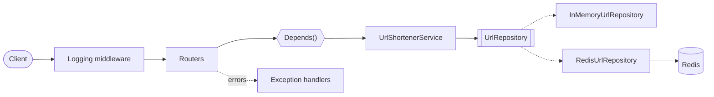

# URL Shortener (FastAPI)

A URL shortener microservice. `POST` a long URL, get a 7-character code, and
`http://<host>/<code>` redirects (302) to the original URL. Storage is Redis, or in-memory for
tests. The lab is written for Flask; the [mapping table](#flask--fastapi) shows the FastAPI
equivalent of each requirement.

## Requirements

- Python 3.14
- Docker Desktop (for Redis and production mode)

Dependencies are pinned in [requirements.txt](requirements.txt) (runtime) and
[requirements-dev.txt](requirements-dev.txt) (runtime + tests).

## Project structure

```
app/
├── main.py            # create_app() factory, lifespan, middleware, routers
├── core/              # config, exceptions, error handlers, middleware, logging
├── api/               # routers, Depends() providers, OpenAPI docs helpers
│   └── routes/        # health.py, urls.py, redirect.py
├── services/          # UrlShortenerService (business logic)
├── storage/           # UrlRepository Protocol + memory and Redis implementations
├── schemas/           # Pydantic models
└── utils/codes.py     # short code generator
tests/
Dockerfile, docker-compose.yml, docker-compose.prod.yml, gunicorn.conf.py
```

## Run locally

```powershell
python -m venv .venv
.\.venv\Scripts\Activate.ps1
pip install -r requirements-dev.txt
Copy-Item .env.example .env
uvicorn app.main:app --reload
```

Open <http://localhost:8000/docs>. The default `STORAGE_BACKEND=memory` needs no Redis.

## Run with Docker

```powershell
docker compose up --build                              # development
docker compose -f docker-compose.prod.yml up --build   # production
docker compose down                                    # stop (-v also deletes Redis data)
```

| | Development | Production |
|---|---|---|
| Server | `uvicorn --reload` | Gunicorn + Uvicorn workers |
| `DEBUG` | `true` | `false` |
| Workers | 1 | `WORKERS` (default 4) |
| Code | mounted volume (hot reload) | copied into the image |

The image is multi-stage (`builder` → `python:3.14-slim` runtime), runs as a non-root user and
has a healthcheck. Compose starts the app only after the Redis healthcheck passes.

## Environment variables

Copy [.env.example](.env.example) to `.env` (never commit `.env`).

| Variable | Default | Description |
|---|---|---|
| `APP_NAME` | `URL Shortener` | Title in the docs |
| `APP_VERSION` | `0.1.0` | Version in the docs |
| `ENVIRONMENT` | `development` | `development` or `production` |
| `DEBUG` | `false` | More detailed logs |
| `BASE_URL` | `http://localhost:8000` | Used to build `short_url` |
| `STORAGE_BACKEND` | `memory` | `memory` or `redis` |
| `REDIS_URL` | `redis://127.0.0.1:6379/0` | Redis address |
| `WORKERS` | `2` | Gunicorn workers in production |

## Endpoints

| Method | Path | Success | Errors |
|---|---|---|---|
| `POST` | `/api/v1/urls` | 201 | 422, 500, 503 |
| `GET` | `/api/v1/urls/{short_code}` | 200 | 404, 422, 500, 503 |
| `GET` | `/{short_code}` | 302 | 404, 422, 500, 503 |
| `GET` | `/health` | 200 | 503 |

```http
POST /api/v1/urls
{"original_url": "https://www.python.org/about/"}

201 Created
{"short_code": "aB3dE9x", "original_url": "https://www.python.org/about/",
 "short_url": "http://localhost:8000/aB3dE9x", "created_at": "2026-11-04T10:15:30Z"}
```

All errors use one shape, and every response has an `X-Request-ID` header:

```json
{"error": {"code": "url_not_found", "message": "Short URL 'aB3dE9x' was not found.", "details": {"short_code": "aB3dE9x"}}}
```

## API docs

Swagger UI is at `/docs`. FastAPI generates OpenAPI **3.1** (the lab mentions 3.0; 3.1 is the
newer version of the same standard). In Swagger, *Try it out* on the redirect shows
"Failed to fetch" because the browser follows the redirect; open the short link in a tab instead.

## Tests

```powershell
pytest                       # Redis tests are skipped if Redis is not running
docker compose up -d redis
pytest                       # all 39 tests
```

The tests use `create_app()` with in-memory storage. The integration tests use Redis database 15.

## Architecture



Routers validate input, `Depends()` injects the service, the service holds the rules, and the
repository is the only part that talks to storage. Shared objects (settings, Redis client,
repository) live in `app.state`, created in the lifespan handler; per-request data (request ID)
lives in `request.state`.

## Flask → FastAPI

| Flask (lab) | FastAPI (this project) |
|---|---|
| App factory | `create_app()` |
| Blueprints | `APIRouter` |
| Flask-Injector | `Depends()` |
| python-decouple | pydantic-settings |
| Flask-RESTX docs | Built-in OpenAPI + Swagger UI |
| App / request context | `app.state` / `Request` |
| `@app.errorhandler` | `app.add_exception_handler` |
| Gunicorn (WSGI) | Gunicorn + Uvicorn workers (ASGI) |

## Design decisions

| Decision | Reason |
|---|---|
| Redirect at the root `/{code}` | Shortest links; registered last so it doesn't hide other routes |
| 302, not 301 | Browsers cache 301 forever; 302 keeps visits going through the service |
| `secrets` for codes | Unpredictable codes (62⁷ ≈ 3.5 trillion) |
| Redis `SET NX` | Two codes can never collide |
| UTC times | Same time for every client |
| Storage Protocol | Swap memory and Redis without changing the service |
